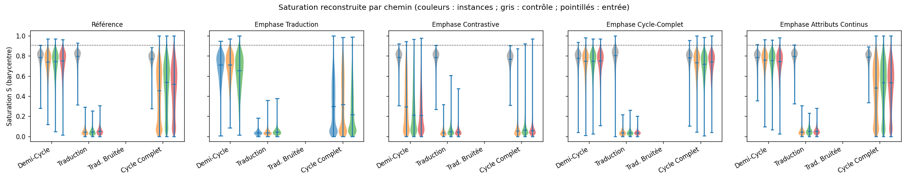
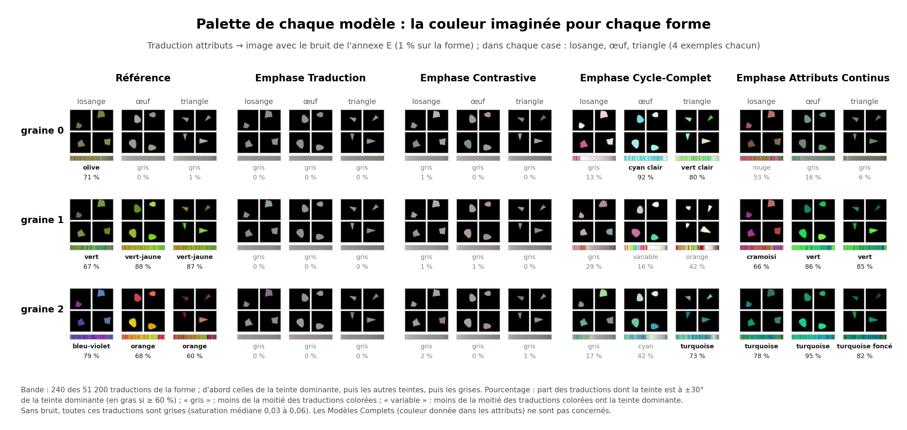

# Compte rendu : saturation des couleurs et synesthésie artificielle

État au 19/11/2026. Travail fait sur la branche `reproducibility`, en complément de la reproduction du
mémoire M2 « Synesthésie artificielle dans un modèle Global Workspace » (`docs/EMANUELLI_Memoire_M2.pdf`).
Le code d'origine est intact : tout passe par de nouvelles options ou de nouveaux scripts, et le bruit
reste désactivé par défaut, donc les résultats du chapitre 3 ne changent pas. Les résultats bruts sont
dans `results/saturation/`, non versionné ; les figures ci-dessous en sont tirées.

## En bref

- Le mémoire étudie la **teinte** des couleurs que les modèles « vide sémantique » (attributs sans
  couleur) inventent. Or, en traduction (attributs → image), ces couleurs sont **presque grises**
  (saturation S ≈ 0,04 contre 0,9 en entrée) : la teinte mesurée au chapitre 3 est celle d'un gris
  légèrement teinté.
- Avec le petit bruit de l'annexe E (1 % de probabilité sur les formes non cibles), trois
  configurations sur cinq (Référence, Emphase Cycle-Complet, Emphase Attributs Continus) produisent des
  **couleurs saturées**, propres à chaque forme et à chaque instance : une vraie synesthésie visible.
- Un balayage montre que c'est **causal** : 0,1 à 1 % de masse résiduelle sur les autres formes suffit
  à colorer la traduction, et la teinte dépend de la direction de ce résidu.
- Une régression montre que la couleur d'entrée est **relisible** dans les attributs décodés, qui n'en
  contiennent pas : en partie dans le résidu des probabilités de forme, en partie dans de petits écarts
  des attributs continus. Ce qui est relisible prédit ce que le cycle complet restitue (ρ = 0,99).
- Le checkpoint du contrôle Emphase Traduction (`epoch=599.ckpt`) reste **introuvable** ici.

## 1. Checkpoint manquant (contrôle Emphase Traduction)

- Introuvable sur cette machine. La seule copie (branche `Non_trimmed_code(end-of-internship)`) est
  tronquée à 2,75 Mio et ne contient aucun poids du GW.
- Emplacement d'origine : machine **Anita**,
  `/home/alexis/Desktop/checkpoints/training_logs/Removing_colors/(Colored) H_T (10) v5/checkpoints/epoch=599.ckpt`
  (ou `last-v2.ckpt`, même contenu). Non vérifiés : disque « Eilat_DS_2 » et deux partitions NTFS.
- Une fois récupéré : `scripts/identify_checkpoints.py <dossier>`, `scripts/package_checkpoints.py
  --located located_checkpoints.yaml`, puis sur Zenodo, record 24208192 → « New version » → remplacer
  l'archive → publier ; mettre ensuite à jour `ZENODO_RECORD` (`scripts/download_checkpoints.sh`), le DOI
  du README et le commentaire de `experiments/thesis_runs.yaml`.
- Le réentraîner donnerait un modèle nouveau, pas celui du tableau B.1 ; le jeu d'entraînement local est
  de plus incomplet (847 Mo au lieu d'environ 7 Go).

## 2. Ce qui a été ajouté au dépôt

| Ajout | Rôle |
|---|---|
| `--hls` (évaluation) | mesure S et L en plus de la teinte |
| `--translation-only`, `--low-memory` (évaluation) | chemin de traduction seul (3 fois plus rapide), mémoire réduite |
| `make_tables.py --channel H/S/L --test` | tableaux de régularité et d'arbitraire sur S et L |
| `experiments/saturation_analysis.py` | régularité et arbitraire de S, avec un critère de taille d'effet |
| `experiments/shape_noise_sweep.py` | balayage du bruit sur la forme, dans le plan tangent au simplexe |
| `experiments/synesthesia_figure.py` | associations forme → couleur les plus nettes, avec de vraies traductions |
| `experiments/residual_regression.py` | relecture de la couleur d'entrée dans les attributs décodés |

Reproduction vérifiée : les lignes Traduction des tableaux B.2 et 3.1, et la ligne Traduction Bruitée du
tableau E.1, sont identiques à celles déjà reproduites.

## 3. Saturation selon le chemin

Témoin : l'image d'entrée a S = 0,91 ; le VAE seul la ramène à 0,80, comme le demi-cycle des contrôles.

| Médiane de S | Traduction | Traduction bruitée (annexe E) | Demi-cycle | Cycle complet |
|---|---|---|---|---|
| Modèles Complets (4 contrôles) | 0,80–0,83 | 0,80–0,84 | 0,79–0,80 | 0,78–0,80 |
| Référence | 0,05 | 0,46 | 0,76 | 0,49 |
| Emphase Traduction | 0,04 | 0,04 | 0,71 | 0,28 |
| Emphase Contrastive | 0,05 | 0,05 | 0,21 | 0,06 |
| Emphase Cycle-Complet | 0,04 | 0,44 | 0,77 | 0,72 |
| Emphase Attributs Continus | 0,05 | 0,62 | 0,77 | 0,51 |

Traduction : valeurs exactes. Demi-cycle et cycle complet : valeurs approchées depuis les résultats du
chapitre 3 (erreur médiane vérifiée < 0,005). En cycle complet, S est souvent bimodale.

**Régularité et arbitraire de S** (traduction) : S diffère entre orientations dans 100 % des instances des
5 configurations, contre 0 paire sur 120 chez les contrôles ; avec le bruit, S diffère aussi entre formes,
de façon propre à chaque instance. Pour la forme et la taille sans bruit, les contrôles diffèrent aussi
(effet de mesure) : non concluant.

## 4. Balayage du bruit sur la forme (cause)

Sur 48 exemples et 36 directions du plan tangent au simplexe, ε de 0,001 à 0,1 :

| Médiane de S | sans bruit | ε = 0,001 | ε = 0,01 | ε = 0,1 |
|---|---|---|---|---|
| Référence (graines 0 / 1 / 2) | 0,05 | 0,06 / 0,26 / 0,42 | 0,08 / 0,71 / 0,79 | 0,22 / 0,79 / 0,91 |
| Emphase Traduction | 0,04 | 0,04–0,05 | 0,04–0,06 | 0,06–0,14 |
| Emphase Contrastive | 0,05 | 0,05 | 0,05 | 0,05–0,09 |
| Emphase Cycle-Complet | 0,03 | 0,29 / 0,04 / 0,04 | 0,87 / 0,84 / 0,53 | 0,99 / 0,92 / 0,92 |
| Emphase Attributs Continus | 0,05 | 0,08 / 0,37 / 0,28 | 0,49 / 0,73 / 0,90 | 0,66 / 0,85 / 0,94 |
| Modèles Complets (4) | 0,80–0,83 | inchangée | inchangée | inchangée |

- Les trois configurations qui répondent sont celles où le tableau E.1 trouve de l'arbitraire sous bruit.
- La forme reste reconnue (95 à 100 % jusqu'à ε = 0,01).
- La teinte varie continûment avec la direction du résidu (60° à 150° d'un extrême à l'autre), diffère
  entre instances et reste stable au sein d'une instance.
- La même perturbation des attributs continus déplace la couleur 10 à 150 fois moins.

## 5. Synesthésie visible : quel modèle voit quelle forme de quelle couleur

Avec le bruit de l'annexe E, 7 modèles sur 15 ont des associations constantes (60 à 95 % des 51 200
traductions d'une forme à ±30° de la même teinte), 16 en tout. Exemples : œufs turquoise (Emphase
Attributs Continus graine 2, 95 %), œufs cyan clair (Emphase Cycle-Complet graine 0, 92 %), losanges
bleu-violet (Référence graine 2, 79 %, seul bleu), losanges cramoisis (Emphase Attributs Continus
graine 1, 66 %). Aucun triangle rouge. Sans bruit, tout est gris ; Emphase Traduction et Emphase
Contrastive restent grises même avec le bruit.

Seules 4 associations gardent leur couleur quelle que soit la forme vers laquelle part le résidu : ce
sont les plus défendables.

## 6. Relecture de la couleur dans les attributs décodés (étape 2)

19 200 images, image → VAE → GW → décodeur d'attributs ; régression de la couleur d'entrée (ridge,
k plus proches voisins, petit perceptron ; meilleure des trois, validation croisée à 5 plis).

| R² de la chrominance (moyenne des graines) | résidu de forme | continus + géométrie | tout | latent GW | transmission en cycle complet (R̄) |
|---|---|---|---|---|---|
| Référence | 0,36 | 0,60 | 0,83 | 0,95 | 0,79 |
| Emphase Traduction | 0,07 | 0,52 | 0,59 | 0,94 | 0,54 |
| Emphase Contrastive | 0,00 | 0,24 | 0,25 | 0,29 | 0,18 |
| Emphase Cycle-Complet | 0,65 | 0,55 | 0,96 | 0,99 | 0,99 |
| Emphase Attributs Continus | 0,40 | 0,58 | 0,90 | 0,96 | 0,84 |
| Modèles Complets (4) | ≤ 0,02 | ≤ 0,13 | ≤ 0,15 | 1,00 | – |

- La couleur est relisible dans 4 configurations sur 5 ; Emphase Contrastive l'a déjà perdue dans
  l'espace de travail.
- Le résidu de forme n'en porte l'essentiel que pour Emphase Cycle-Complet graine 0 (0,96) ; presque
  rien pour Emphase Traduction. Le reste passe par les écarts des attributs continus, lisibles seulement
  avec la géométrie.
- Ce qui est relisible classe les modèles comme la transmission en cycle complet (ρ de Spearman 0,99).

## 7. En cours et reste à faire

- **Étape 4, robustesse** (en cours) : autre extraction de la couleur (pixel le plus intérieur du
  masque), autres graines et amplitudes du bruit de l'annexe E, correction pour comparaisons multiples,
  sensibilité de la régression au tirage des images. Résultats à venir dans `results/saturation/robustesse/`.
- **Le GW lit-il les écarts des attributs continus ?** Les perturber selon les directions qui portent la
  couleur, et non au hasard, puis mesurer la couleur traduite.
- Évaluation exacte de S en demi-cycle et en cycle complet (environ 35 min par modèle), si les valeurs
  approchées ne suffisent pas.
- Récupérer `epoch=599.ckpt` sur Anita (§ 1).
