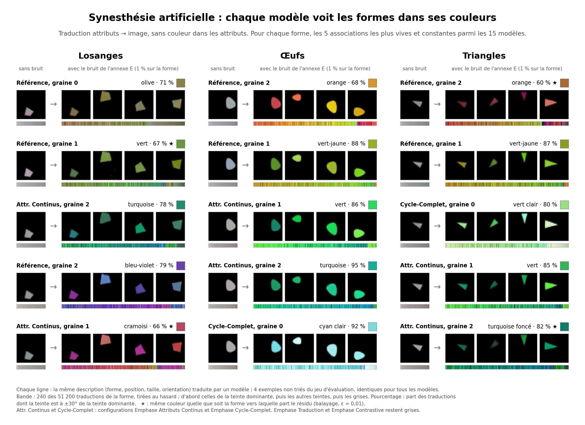

# Compte rendu : saturation des couleurs et synesthésie artificielle

État au 19/11/2026. Travail fait sur la branche `reproducibility`, en complément de la reproduction du
mémoire M2 « Synesthésie artificielle dans un modèle Global Workspace » (`docs/EMANUELLI_Memoire_M2.pdf`).
Le code d'origine est intact : tout passe par de nouvelles options ou de nouveaux scripts, et le bruit
reste désactivé par défaut, donc les résultats du chapitre 3 ne changent pas. Les résultats bruts sont
dans `results/saturation/`, non versionné ; les figures ci-dessous en sont tirées.

## En bref

- Le mémoire étudie la **teinte** des couleurs que les modèles « vide sémantique » (attributs sans
  couleur) inventent. Or, en traduction (attributs → image), ces couleurs sont **presque grises**
  (saturation S ≈ 0,04 contre 0,9 en entrée) : la teinte mesurée au chapitre 3 est celle d'un gris
  légèrement teinté.
- Avec le petit bruit de l'annexe E (1 % de probabilité sur les formes non cibles), trois
  configurations sur cinq (Référence, Emphase Cycle-Complet, Emphase Attributs Continus) produisent des
  **couleurs saturées**, propres à chaque forme et à chaque instance : une vraie synesthésie visible.
- Une **intervention** sur la seule entrée de forme (modèle déterministe, tout le reste fixé) le
  confirme : retirer 0,7 à 0,8 % de masse à la forme cible fait passer S de 0,03–0,06 à 0,50–0,93
  dans 8 des 9 instances de ces trois configurations (34 à 48 exemples colorés sur 48 ; Wilcoxon
  apparié, p < 10⁻⁴ après correction de Holm), avec une relation dose-réponse monotone. La même
  perturbation appliquée aux attributs continus déplace la couleur 10 à 166 fois moins. La teinte
  obtenue dépend fortement de la forme qui reçoit le résidu dans 4 instances, faiblement (15 à 30°)
  dans 4 autres (§ 4, annexe A).
- Une régression montre que la couleur d'entrée est **relisible** dans les attributs décodés, qui n'en
  contiennent pas : en partie dans le résidu des probabilités de forme, en partie dans de petits écarts
  des attributs continus. Ce qui est relisible prédit ce que le cycle complet restitue (ρ = 0,99).
- Le checkpoint du contrôle Emphase Traduction (`epoch=599.ckpt`) reste **introuvable** ici.

## 1. Checkpoint manquant (contrôle Emphase Traduction)

- Introuvable sur cette machine. La seule copie (branche `Non_trimmed_code(end-of-internship)`) est
  tronquée à 2,75 Mio et ne contient aucun poids du GW.
- Emplacement d'origine : machine **Anita**,
  `/home/alexis/Desktop/checkpoints/training_logs/Removing_colors/(Colored) H_T (10) v5/checkpoints/epoch=599.ckpt`
  (ou `last-v2.ckpt`, même contenu). Non vérifiés : disque « Eilat_DS_2 » et deux partitions NTFS.
- Une fois récupéré : `scripts/identify_checkpoints.py <dossier>`, `scripts/package_checkpoints.py
  --located located_checkpoints.yaml`, puis sur Zenodo, record 24208192 → « New version » → remplacer
  l'archive → publier ; mettre ensuite à jour `ZENODO_RECORD` (`scripts/download_checkpoints.sh`), le DOI
  du README et le commentaire de `experiments/thesis_runs.yaml`.
- Le réentraîner donnerait un modèle nouveau, pas celui du tableau B.1 ; le jeu d'entraînement local est
  de plus incomplet (847 Mo au lieu d'environ 7 Go).

## 2. Ce qui a été ajouté au dépôt

| Ajout | Rôle |
|---|---|
| `--hls` (évaluation) | mesure S et L en plus de la teinte |
| `--translation-only`, `--low-memory` (évaluation) | chemin de traduction seul (3 fois plus rapide), mémoire réduite |
| `make_tables.py --channel H/S/L --test` | tableaux de régularité et d'arbitraire sur S et L |
| `experiments/saturation_analysis.py` | régularité et arbitraire de S, avec un critère de taille d'effet |
| `experiments/shape_noise_sweep.py` | balayage du bruit sur la forme, dans le plan tangent au simplexe |
| `experiments/sweep_statistics.py` | statistiques du balayage : IC, tests appariés corrigés, spécificité, résidus réels (annexe A) |
| `experiments/synesthesia_figure.py` | associations forme → couleur les plus nettes, avec de vraies traductions |
| `experiments/residual_regression.py` | relecture de la couleur d'entrée dans les attributs décodés |

Reproduction vérifiée : les lignes Traduction des tableaux B.2 et 3.1, et la ligne Traduction Bruitée du
tableau E.1, sont identiques à celles déjà reproduites.

## 3. Saturation selon le chemin

Témoin : l'image d'entrée a S = 0,91 ; le VAE seul la ramène à 0,80, comme le demi-cycle des contrôles.

| Médiane de S | Traduction | Traduction bruitée (annexe E) | Demi-cycle | Cycle complet |
|---|---|---|---|---|
| Modèles Complets (4 contrôles) | 0,80–0,83 | 0,80–0,84 | 0,79–0,80 | 0,78–0,80 |
| Référence | 0,05 | 0,46 | 0,76 | 0,49 |
| Emphase Traduction | 0,04 | 0,04 | 0,71 | 0,28 |
| Emphase Contrastive | 0,05 | 0,05 | 0,21 | 0,06 |
| Emphase Cycle-Complet | 0,04 | 0,44 | 0,77 | 0,72 |
| Emphase Attributs Continus | 0,05 | 0,62 | 0,77 | 0,51 |

Traduction : valeurs exactes. Demi-cycle et cycle complet : valeurs approchées depuis les résultats du
chapitre 3 (erreur médiane vérifiée < 0,005). En cycle complet, S est souvent bimodale.

**Régularité et arbitraire de S** (traduction) : S diffère entre orientations dans 100 % des instances des
5 configurations, contre 0 paire sur 120 chez les contrôles ; avec le bruit, S diffère aussi entre formes,
de façon propre à chaque instance. Pour la forme et la taille sans bruit, les contrôles diffèrent aussi
(effet de mesure) : non concluant.

## 4. Balayage du bruit sur la forme : effet de la masse résiduelle

**Protocole.** Chemin de traduction (attributs → GW → image). On ne modifie que le vecteur de forme
donné en entrée : one-hot + ε·u, où u est un vecteur unitaire du plan tangent au simplexe. Toutes les
autres entrées restent fixes et le modèle est déterministe : sur un exemple donné, l'écart observé est
donc l'effet de cette seule modification. Les directions admissibles (240° à 300°) gardent le vecteur
dans le simplexe et retirent 0,71 ε à 0,82 ε de masse à la forme cible, soit 0,07–0,08 % à ε = 0,001
et 0,7–0,8 % à ε = 0,01. 48 exemples (3 formes × 4 orientations × 2 tailles × 2 positions),
7 directions admissibles, 9 amplitudes de 0,001 à 0,1.

- **Témoin de spécificité** : même norme ε appliquée aux 5 attributs continus (36 directions
  aléatoires).
- **Témoins négatifs** : les 4 Modèles Complets.
- **Statistiques** : l'unité est l'exemple, avec une valeur par exemple (médiane sur les directions).
  Tests appariés de Wilcoxon, intervalles de confiance par bootstrap des exemples, correction de Holm.
  Il n'y a que 3 instances par configuration : la généralisation à une configuration repose sur ce
  nombre.

Tableaux complets : [annexe A](annexes/A_statistiques_balayage.md), produite par
`experiments/sweep_statistics.py`.

**Résultat 1 : la masse résiduelle colore la traduction.**

| Instance | S sans bruit | S à ε = 0,001 [IC 95 %] | S à ε = 0,01 [IC 95 %] | colorés (S ≥ 0,3) à ε = 0,01 | ΔC forme / ΔC continus à ε = 0,001 [IC 95 %] |
|---|---|---|---|---|---|
| Référence graine 0 | 0,05 | 0,07 [0,05–0,09] | 0,10 [0,06–0,30] | 17/48 | 2,2 [1,5–12,0] |
| Référence graine 1 | 0,05 | 0,23 [0,19–0,27] | 0,71 [0,66–0,76] | 48/48 | 118 [93–134] |
| Référence graine 2 | 0,06 | 0,45 [0,42–0,49] | 0,81 [0,78–0,84] | 48/48 | 166 [134–176] |
| Emphase Cycle-Complet graine 0 | 0,03 | 0,24 [0,17–0,40] | 0,81 [0,76–0,88] | 48/48 | 133 [118–152] |
| Emphase Cycle-Complet graine 1 | 0,03 | 0,04 [0,03–0,06] | 0,85 [0,79–0,90] | 46/48 | 84 [64–118] |
| Emphase Cycle-Complet graine 2 | 0,03 | 0,04 [0,04–0,06] | 0,59 [0,46–0,68] | 39/48 | 85 [67–103] |
| Emphase Attributs Continus graine 0 | 0,05 | 0,09 [0,07–0,13] | 0,50 [0,37–0,60] | 34/48 | 10 [8–16] |
| Emphase Attributs Continus graine 1 | 0,05 | 0,38 [0,31–0,41] | 0,75 [0,71–0,78] | 48/48 | 108 [83–120] |
| Emphase Attributs Continus graine 2 | 0,05 | 0,30 [0,27–0,33] | 0,93 [0,89–0,95] | 48/48 | 95 [88–113] |
| Emphase Traduction (3 graines) | 0,04–0,05 | 0,04–0,05 | 0,04–0,06 | 0/48 | 0,6 à 2,1 |
| Emphase Contrastive (3 graines) | 0,04–0,06 | 0,04–0,06 | 0,05 | 0 à 3/48 | 0,4 à 1,1 |
| Modèles Complets (4) | 0,80–0,83 | 0,80–0,83 | 0,80–0,83 | 48/48 | 0,5 à 56 |

- **Effet** : dans 8 des 9 instances de Référence, Emphase Cycle-Complet et Emphase Attributs
  Continus, S passe de 0,03–0,06 à 0,50–0,93 à ε = 0,01, avec 34 à 48 exemples colorés sur 48
  (p < 10⁻⁴ après correction de Holm sur 57 tests).
- **Dose-réponse** : S croît avec ε pour 45 à 48 exemples sur 48 (ρ de Spearman médian par exemple :
  0,91 à 1,00).
- **Seuil** : dès ε = 0,001 (0,07 % de masse), la médiane atteint S ≥ 0,3 dans 2 instances, et dès
  ε = 0,0018 dans 2 autres.
- **Exception** : Référence graine 0 ne répond presque pas (S = 0,10 à ε = 0,01), sauf pour les
  losanges.
- **Spécificité** : à norme égale, perturber les attributs continus déplace la couleur 10 à 166 fois
  moins (borne basse des IC ≥ 7,8), sauf chez Référence graine 0 (2,2).
- **Témoins négatifs** : chez les Modèles Complets, S ne change pas (écart ≤ 0,01). Chez Emphase
  Traduction et Emphase Contrastive, la traduction reste grise (S ≤ 0,06). Quelques p y sont faibles,
  mais l'effet est négligeable (ΔS ≤ 0,01) : un p seul ne suffit pas, d'où les tailles d'effet.
- **Réserve** : chez le contrôle d'Emphase Cycle-Complet, la masse résiduelle déplace aussi la couleur
  (ΔC = 32 à ε = 0,01, rapport 56 à ε = 0,001) sans changer S. La sensibilité au résidu de forme est
  donc en partie une propriété de cette configuration, indépendamment du vide sémantique.

**Plage balayée et résidus réels.** Le décodeur d'attributs, appliqué à 19 200 vraies images, produit
lui-même une masse résiduelle :
- **Emphase Cycle-Complet** : médiane de 0,4 à 1 %, en plein dans la plage balayée ; c'est aussi le cas
  de son contrôle.
- **Référence et Emphase Attributs Continus** : médiane de 0,01 à 0,02 %, mais 25 à 31 % des images
  dépassent 0,07 %.
- **Emphase Traduction et Emphase Contrastive** : masse résiduelle quasi nulle, ce qui est cohérent avec
  le R² nul du résidu au § 6.

**Résultat 2 : la teinte dépend de la forme qui reçoit le résidu, nettement dans 4 instances.** On
compare la teinte entre les deux répartitions extrêmes (tout le résidu sur l'une ou l'autre des formes
non cibles), à ε = 0,01. Seuls entrent les exemples colorés aux deux extrêmes (S ≥ 0,3), car la teinte
d'un gris n'a pas de sens. Le plancher de mesure, 99e centile de l'écart chez les contrôles, vaut 15°.
- **Forte dépendance** : Emphase Cycle-Complet, 3 instances sur 3 (écart médian de 65° à 156°, 100 % des
  exemples au-dessus du plancher, n = 16 à 43), et Emphase Attributs Continus graine 0 (140°, 8/8).
- **Faible dépendance** : Référence graine 1 (18°, 6/11 au-dessus du plancher) et Emphase Attributs
  Continus graine 1 (16°, 8/16).
- **Trop peu d'exemples à S ≥ 0,3** : Référence graine 2 (n = 2) et Emphase Attributs Continus graine 2
  (n = 3). Avec un seuil S ≥ 0,15, on obtient respectivement 27° (14/18) et 14° (3/7).
- **Non testable** : Référence graine 0, Emphase Traduction et Emphase Contrastive, faute d'exemples
  colorés.
- **Continuité non établie** : entre directions voisines (10°), le plus grand saut atteint 74° en
  médiane chez Emphase Cycle-Complet graine 0, et la teinte ne varie dans un seul sens que dans 25 à
  82 % des exemples selon l'instance (instances avec n ≥ 8).
- **Correction** : la version précédente de ce compte rendu annonçait « 60° à 150° » entre les deux
  extrêmes. Ce chiffre comptait aussi des couleurs presque grises, dont la teinte n'est pas fiable ; il
  est remplacé par les valeurs ci-dessus.

**Récapitulatif de la saturation selon ε** (médiane sur exemples et directions admissibles) :

| Médiane de S | sans bruit | ε = 0,001 | ε = 0,01 | ε = 0,1 |
|---|---|---|---|---|
| Référence (graines 0 / 1 / 2) | 0,05 | 0,06 / 0,26 / 0,42 | 0,08 / 0,71 / 0,79 | 0,22 / 0,79 / 0,91 |
| Emphase Traduction | 0,04 | 0,04–0,05 | 0,04–0,06 | 0,06–0,14 |
| Emphase Contrastive | 0,05 | 0,05 | 0,05 | 0,05–0,09 |
| Emphase Cycle-Complet | 0,03 | 0,29 / 0,04 / 0,04 | 0,87 / 0,84 / 0,53 | 0,99 / 0,92 / 0,92 |
| Emphase Attributs Continus | 0,05 | 0,08 / 0,37 / 0,28 | 0,49 / 0,73 / 0,90 | 0,66 / 0,85 / 0,94 |
| Modèles Complets (4) | 0,80–0,83 | inchangée | inchangée | inchangée |

- Les trois configurations qui répondent sont celles où le tableau E.1 trouve de l'arbitraire sous bruit.
- La forme reste reconnue (image traduite → GW → attributs) dans 95 à 100 % des cas jusqu'à ε = 0,01,
  sauf Emphase Cycle-Complet graine 1 (72 %) et son contrôle (85 %).
- À répartition du résidu égale (270°), la teinte diffère entre les 3 instances d'une configuration
  (test de permutation, p ≤ 0,04 pour chaque forme et chaque direction testée, dans les 3
  configurations qui répondent).

## 5. Synesthésie visible : quel modèle voit quelle forme de quelle couleur

Avec le bruit de l'annexe E, 7 modèles sur 15 ont des associations constantes (60 à 95 % des 51 200
traductions d'une forme à ±30° de la même teinte), 16 en tout. Exemples : œufs turquoise (Emphase
Attributs Continus graine 2, 95 %), œufs cyan clair (Emphase Cycle-Complet graine 0, 92 %), losanges
bleu-violet (Référence graine 2, 79 %, seul bleu), losanges cramoisis (Emphase Attributs Continus
graine 1, 66 %). Aucun triangle rouge. Sans bruit, tout est gris ; Emphase Traduction et Emphase
Contrastive restent grises même avec le bruit.

Seules 4 associations gardent leur couleur quelle que soit la forme vers laquelle part le résidu : ce
sont les plus défendables.

## 6. Relecture de la couleur dans les attributs décodés (étape 2)

19 200 images, image → VAE → GW → décodeur d'attributs ; régression de la couleur d'entrée (ridge,
k plus proches voisins, petit perceptron ; meilleure des trois, validation croisée à 5 plis).

| R² de la chrominance (moyenne des graines) | résidu de forme | continus + géométrie | tout | latent GW | transmission en cycle complet (R̄) |
|---|---|---|---|---|---|
| Référence | 0,36 | 0,60 | 0,83 | 0,95 | 0,79 |
| Emphase Traduction | 0,07 | 0,52 | 0,59 | 0,94 | 0,54 |
| Emphase Contrastive | 0,00 | 0,24 | 0,25 | 0,29 | 0,18 |
| Emphase Cycle-Complet | 0,65 | 0,55 | 0,96 | 0,99 | 0,99 |
| Emphase Attributs Continus | 0,40 | 0,58 | 0,90 | 0,96 | 0,84 |
| Modèles Complets (4) | ≤ 0,02 | ≤ 0,13 | ≤ 0,15 | 1,00 | – |

- La couleur est relisible dans 4 configurations sur 5 ; Emphase Contrastive l'a déjà perdue dans
  l'espace de travail.
- Le résidu de forme n'en porte l'essentiel que pour Emphase Cycle-Complet graine 0 (0,96) ; presque
  rien pour Emphase Traduction. Le reste passe par les écarts des attributs continus, lisibles seulement
  avec la géométrie.
- Ce qui est relisible classe les modèles comme la transmission en cycle complet (ρ de Spearman 0,99).

## 7. En cours et reste à faire

- **Étape 4, robustesse** (en cours) : autre extraction de la couleur (pixel le plus intérieur du
  masque), autres graines et amplitudes du bruit de l'annexe E, correction pour comparaisons multiples,
  sensibilité de la régression au tirage des images. Résultats à venir dans `results/saturation/robustesse/`.
- **Le GW lit-il les écarts des attributs continus ?** Les perturber selon les directions qui portent la
  couleur, et non au hasard, puis mesurer la couleur traduite.
- **Plus d'instances** : 3 par configuration limitent la généralisation (Référence graine 0 se
  comporte autrement que les graines 1 et 2).
- Mêmes statistiques (IC, tailles d'effet, correction) pour les §§ 3, 5 et 6, sur le modèle de
  l'annexe A.
- Évaluation exacte de S en demi-cycle et en cycle complet (environ 35 min par modèle), si les valeurs
  approchées ne suffisent pas.
- Récupérer `epoch=599.ckpt` sur Anita (§ 1).
