# Couleurs inventées par un Global Workspace privé de couleur : saturation, mécanisme et robustesse d'une synesthésie artificielle

Compte rendu de travaux — 20 novembre 2026. Code : branche `reproducibility` du dépôt
`AEmanuelli/GWT-Synesthesia`. Résultats bruts : `results/saturation/` (non versionné). Tableaux
détaillés : [annexe A](annexes/A_statistiques_balayage.md) (intervention sur la forme) et
[annexe B](annexes/B_robustesse.md) (robustesse).

## Résumé

Un Global Workspace (GW) bimodal relie un domaine image et un domaine « attributs » (forme, taille,
position, orientation). Quand la couleur est retirée des attributs, traduire des attributs en image
oblige le modèle à produire une couleur qu'on ne lui donne pas. Des travaux antérieurs [1] ont
rapporté que la **teinte** de ces couleurs dépend de la forme ou de l'orientation au sein d'un modèle
(régularité) et change d'un modèle à l'autre (arbitraire), par analogie avec la synesthésie. Nous
avons mesuré la **saturation** et la **luminosité** de ces couleurs, cherché d'où elles viennent, et
testé la robustesse des conclusions, sur 15 modèles sans couleur (5 configurations d'entraînement ×
3 graines) et 4 modèles de contrôle qui reçoivent la couleur.

**Principaux résultats**

1. **Sans perturbation, les couleurs inventées sont presque grises** : saturation médiane S = 0,04 à
   0,05 en traduction, contre 0,91 en entrée et 0,80 à 0,83 chez les contrôles. La teinte de ces
   traductions est celle d'un gris très légèrement teinté (§ 3.2).
2. **Une infime masse de probabilité sur les formes non cibles les colore** : retirer 0,7 à 0,8 % de
   masse à la forme cible fait passer S de 0,03–0,06 à 0,50–0,93 dans 8 des 9 instances de trois
   configurations (Référence, Emphase Cycle-Complet, Emphase Attributs Continus), avec une relation
   dose-réponse croissante, sans effet chez les contrôles. La même perturbation appliquée aux
   attributs continus déplace la couleur 10 à 166 fois moins (§ 3.4).
3. **La couleur produite dépend de la direction de ce résidu** (vers quelle forme non cible part la
   masse) : fortement dans 4 instances, faiblement dans 4 autres. Les associations forme → couleur
   (par exemple « losanges bleu-violet ») ne valent donc que pour une direction de bruit donnée :
   9 associations sur 15 restent stables pour au moins 4 graines de bruit sur 6, aucune pour les 6
   (§ 3.4, § 3.5).
4. **La couleur de l'image d'entrée est lisible dans les attributs décodés, qui n'en contiennent
   pas** (R² de 0,57 à 0,98 dans 4 configurations, contre 0,15 au plus chez les contrôles) : en
   partie dans le résidu des probabilités de forme, en partie dans de petits écarts des attributs
   continus. Ce qui est lisible prédit ce que le cycle complet restitue (ρ de Spearman 0,99) (§ 3.6).
5. **Le test statistique utilisé dans [1] ne résiste pas à la correction pour comparaisons
   multiples** (la régularité de la teinte selon l'orientation, en traduction, passe de 3 instances
   sur 3 à 1 sur 3) ; un critère de taille d'effet, stable sous correction, retrouve la conclusion
   qualitative (§ 3.3).
6. **Limites** : 3 instances par configuration seulement ; contrôle de la configuration Emphase
   Traduction indisponible ; valeurs de S approchées pour le demi-cycle et le cycle complet (§ 4).

## 1. Question

Dans un GW, des encodeurs projettent chaque domaine dans un espace de travail commun, d'où des
décodeurs reconstruisent chaque domaine [2, 3]. Trois chemins nous intéressent :

- **demi-cycle** : image → GW → image ;
- **traduction** : attributs → GW → image ;
- **cycle complet** : image → GW → attributs → GW → image.

Si les attributs ne décrivent pas la couleur (« vide sémantique »), la traduction doit inventer une
couleur. Trois questions :

1. Ces couleurs inventées sont-elles de vraies couleurs, ou des gris légèrement teintés ?
2. D'où vient l'information de couleur, puisque l'entrée de la traduction n'en contient pas ?
3. Les régularités et l'arbitraire rapportés résistent-ils à d'autres mesures, à d'autres
   perturbations et à la correction pour comparaisons multiples ?

## 2. Matériel et méthodes

### 2.1 Modèles

GW de la bibliothèque `shimmer` [2], entraînés sur le Simple Shapes Dataset [2]. Domaine image : latent
(12 dimensions) d'un VAE pré-entraîné. Domaine attributs : probabilités des 3 formes (losange, œuf,
triangle) et 5 attributs continus (position x et y, taille, cosinus et sinus de l'orientation), plus 3
composantes de couleur pour les modèles de contrôle.

| Configuration | Traduction | Contrastive | Demi-cycle | Cycle | Poids des attributs continus | Pas d'entraînement (graines 0, 1, 2) |
|---|---|---|---|---|---|---|
| Référence | 1 | 0,1 | 1 | 1 | ×1 | 299 862 ; 206 550 ; 299 376 |
| Emphase Traduction | **10** | 0,1 | 1 | 1 | ×1 | 283 824 ; 216 027 ; 230 607 |
| Emphase Contrastive | 1 | **1** | 1 | 1 | ×1 | 299 376 ; 297 675 ; 297 675 |
| Emphase Cycle-Complet | 1 | 0,1 | 1 | **10** | ×1 | 295 245 ; 297 189 ; 297 918 |
| Emphase Attributs Continus | 1 | 0,1 | 1 | 1 | **×5** | 299 133 ; 294 030 ; 294 516 |

Coefficients des pertes. Chaque configuration a 3 instances sans couleur (« vide sémantique ») et un
**contrôle** (« Modèle Complet ») entraîné avec la couleur dans les attributs (147 000 à 294 000 pas).
Le contrôle d'Emphase Traduction est indisponible (§ 6) : il y a 4 contrôles.

### 2.2 Données d'évaluation

153 600 images de 32 × 32 pixels, une forme par image : 3 formes × 25 teintes × 8 tailles (7 à 14
pixels) × 16 orientations (pas de 22,5°) × 16 positions (grille 4 × 4). Les 25 teintes ont la même
saturation (S = 0,91) et la même luminosité (L = 0,71, HLS) : seule la teinte varie.

### 2.3 Chemins et perturbations

- **Traduction** : on donne au modèle les attributs d'une image (forme en one-hot) et on décode
  l'image.
- **Traduction bruitée** : comme [1], on ajoute au one-hot de forme un vecteur fixe tiré une fois
  pour toutes (3 valeurs N(0, 1) × 0,01, graine 42), puis on renormalise. La forme cible perd environ
  1 % de masse au profit des autres. C'est le **même vecteur pour toutes les images**, donc une
  direction de résidu unique.
- **Intervention contrôlée** (§ 3.4) : one-hot + ε·u, avec u un vecteur unitaire du plan tangent au
  simplexe (36 directions) et ε de 0,001 à 0,1, toutes les autres entrées fixées.
- **Demi-cycle et cycle complet** : à partir des 153 600 images.

### 2.4 Mesure de la couleur

Masque de la forme par seuillage d'Otsu, couleur moyenne des 3 × 3 pixels autour du barycentre du
masque. On en tire la teinte H, la luminosité L et la saturation S (HLS), et la position dans un plan
de chrominance a = R − (G + B)/2, b = √3/2 (G − B) (unités RGB 0-255) : l'angle de (a, b) est la
teinte, sa norme la chroma. Ce plan reste défini pour une couleur presque grise. Une autre extraction
(pixel le plus intérieur du masque) sert de contrôle (§ 3.7).

### 2.5 Statistiques

- **Régularité** : au sein d'une instance, deux catégories d'un attribut (deux formes, deux
  orientations…) donnent-elles des distributions de couleur différentes ? **Arbitraire** : pour une
  même catégorie, deux instances diffèrent-elles ?
- Trois critères : le **test de [1]** (Kolmogorov-Smirnov sur histogrammes à 15 classes, dont
  l'effectif dépend de l'étendue des valeurs) ; **KS sur valeurs brutes** ; **critère d'effet** (KS brut
  p < 0,05 et |δ de Cliff| ≥ 0,147, seuil d'un petit effet).
- Corrections de Holm (et Benjamini-Hochberg) par tableau. Intervalles de confiance (IC) à 95 % par
  bootstrap de l'unité statistique, ou de Wilson pour une proportion. L'unité est précisée à chaque
  analyse (exemple, image, paire, modèle).
- **Constance** d'une association forme → couleur : part des traductions de la forme dont la teinte est
  à ±30° de la teinte dominante. **Transmission en cycle complet** : R̄ = |moyenne de
  exp(i(h_sortie − h_entrée))| (1 : teinte restituée ; 0 : sans rapport).

**Vérification.** L'évaluation refaite pour ce travail redonne à l'identique les tableaux de régularité
de la teinte en traduction publiés dans [1]. Avec le bruit, elle redonne la reproduction déjà
documentée dans le dépôt, qui diffère de [1] sur quelques cases (README, § 5).

## 3. Résultats

### 3.1 Témoin de mesure

Sur 6 000 images, sans GW : l'extraction redonne S = 0,907 en entrée (0,884 pour les triangles, 0,876
pour la plus petite taille : le patch touche les bords). Le seul passage par le VAE (image → VAE →
image) ramène S à 0,80 (losange 0,81, œuf 0,83, triangle 0,72 ; taille 7 : 0,70, taille 14 : 0,83).
**Un écart de S entre formes ou tailles peut donc venir de la mesure** ; les contrôles servent de
référence pour chaque comparaison.

### 3.2 Les couleurs inventées sont presque grises sans perturbation

| Médiane de S (entrée : 0,91) | Demi-cycle* | Traduction | Traduction bruitée | Cycle complet* |
|---|---|---|---|---|
| Contrôles (4) | 0,79–0,80 | 0,80–0,83 | 0,80–0,84 | 0,78–0,80 |
| Référence | 0,76 | 0,05 | 0,46 | 0,49 |
| Emphase Traduction | 0,71 | 0,04 | 0,04 | 0,28 |
| Emphase Contrastive | 0,21 | 0,05 | 0,05 | 0,06 |
| Emphase Cycle-Complet | 0,77 | 0,04 | 0,44 | 0,72 |
| Emphase Attributs Continus | 0,77 | 0,05 | 0,62 | 0,51 |

Médiane sur les 3 instances et toutes les images. Traduction : valeurs exactes. \* Valeurs approchées,
recalculées depuis des RGB arrondis à l'entier (erreur médiane vérifiée sur un modèle : −0,004 en
demi-cycle, −0,001 en cycle complet). Luminosité L (entrée 0,71) : 0,57 à 0,62 en traduction ; avec le
bruit, 0,44 pour Référence et Emphase Attributs Continus (couleurs saturées et plus sombres), 0,66 pour
Emphase Cycle-Complet ; contrôles 0,70 à 0,77.

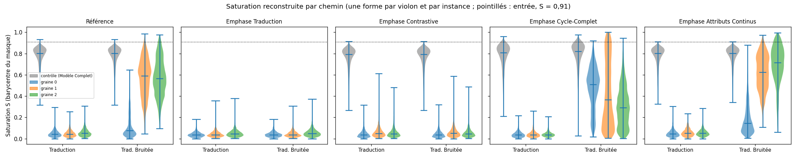

**Figure 1 — Saturation des traductions, avec et sans bruit (valeurs exactes).** Un panneau par
configuration ; dans chaque groupe, un violon par instance (gris : contrôle ; bleu, orange, vert :
graines 0, 1, 2), toutes formes confondues ; trait horizontal : médiane ; pointillés : saturation de
l'entrée. Sans bruit, toutes les instances sans couleur sont grises (S ≈ 0,05). Avec le bruit, Référence
(graines 1 et 2), Emphase Cycle-Complet et Emphase Attributs Continus (graines 1 et 2) produisent des
couleurs saturées, avec de larges distributions ; Référence graine 0 et Emphase Attributs Continus
graine 0 restent peu saturées ; Emphase Traduction et Emphase Contrastive restent grises. Les contrôles
ne changent pas. Emphase Traduction n'a pas de contrôle.

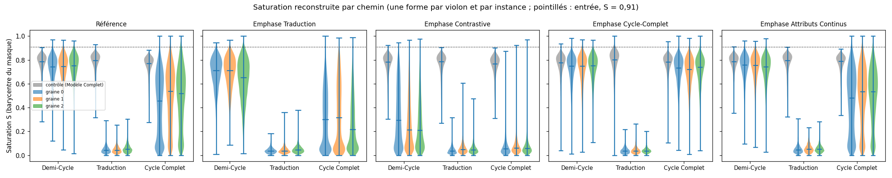

**Figure 2 — Saturation selon le chemin (demi-cycle et cycle complet approchés).** Même codage. En
demi-cycle, les modèles sans couleur reconstruisent des couleurs presque aussi saturées que les
contrôles, sauf Emphase Contrastive (médiane 0,21 : la plupart des images ressortent presque grises).
En cycle complet, la
distribution est souvent **bimodale** : une partie des images ressort saturée, l'autre grise ; seule
Emphase Cycle-Complet garde des couleurs saturées pour presque toutes les images (médiane 0,72), et
Emphase Contrastive les perd presque toutes (0,06).

<b>Figure 3 — Saturation par forme, traduction et traduction bruitée (5 configurations)</b>

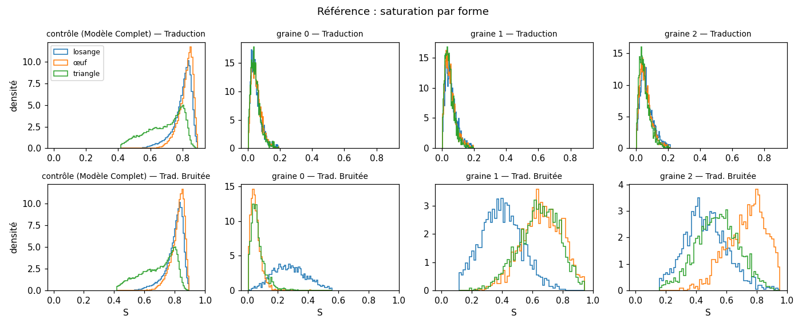
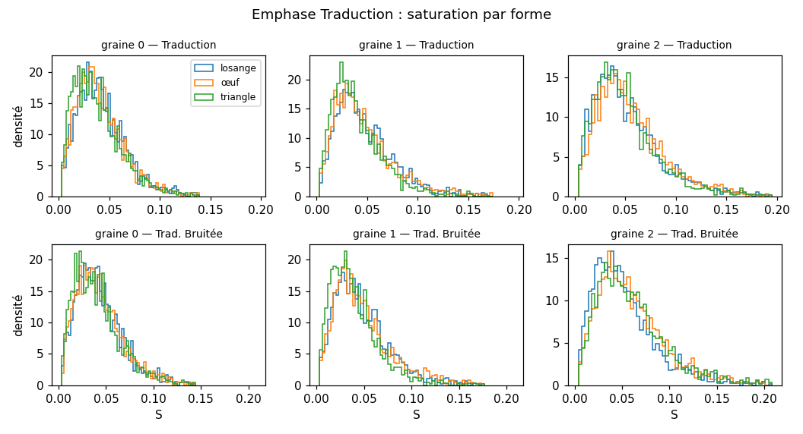
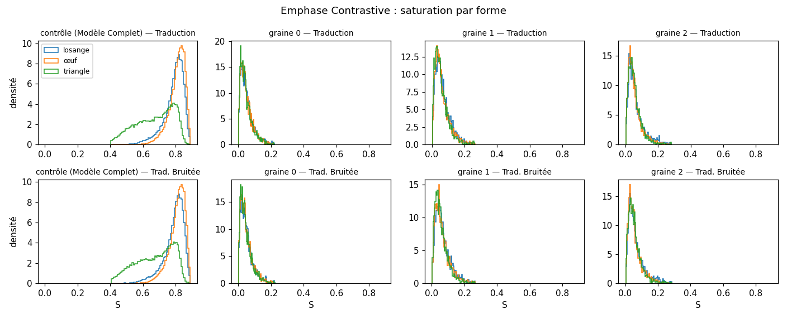
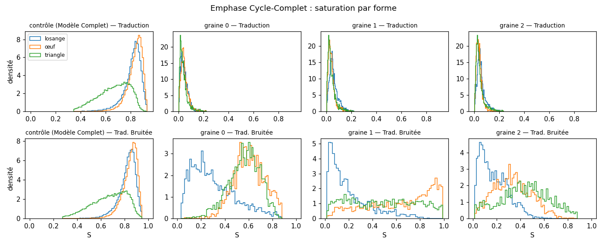
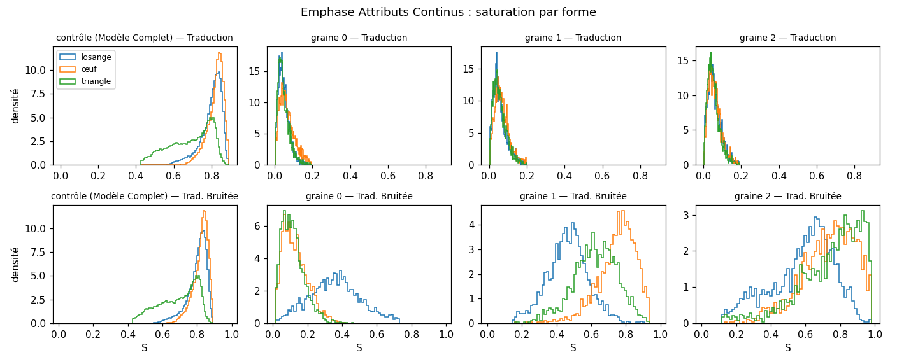

**Figure 3 — Distribution de S par forme et par instance, en traduction (ligne du haut) et en
traduction bruitée (ligne du bas)** ; a : Référence, b : Emphase Traduction, c : Emphase Contrastive,
d : Emphase Cycle-Complet, e : Emphase Attributs Continus ; colonnes : contrôle puis graines 0 à 2 ;
histogrammes normalisés (densité). Sans bruit, les trois formes se superposent près de 0. Avec le bruit,
les formes se séparent, différemment selon l'instance : chez Référence, les losanges sont moins saturés
que les œufs et les triangles (graines 1 et 2) ; chez Emphase Cycle-Complet graine 0, les losanges sont
autour de 0,2 et les deux autres formes autour de 0,6. Chez les contrôles, les triangles sont moins
saturés que les autres formes, avec ou sans bruit : c'est l'effet de mesure du § 3.1.

<b>Figure 4 — Saturation par forme, traduction et cycle complet (5 configurations)</b>

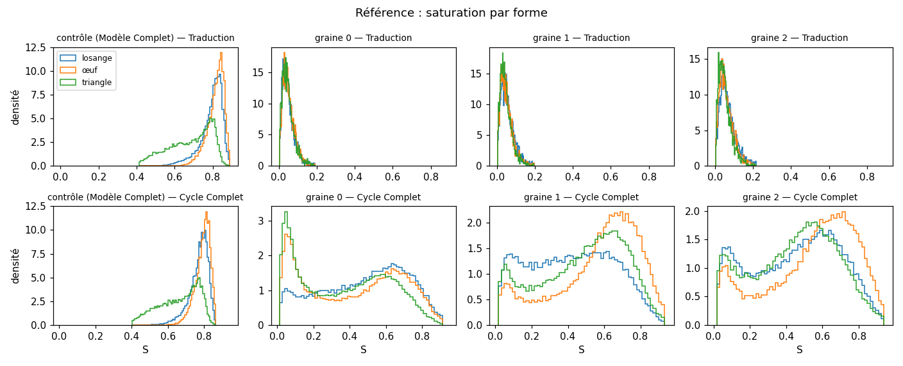
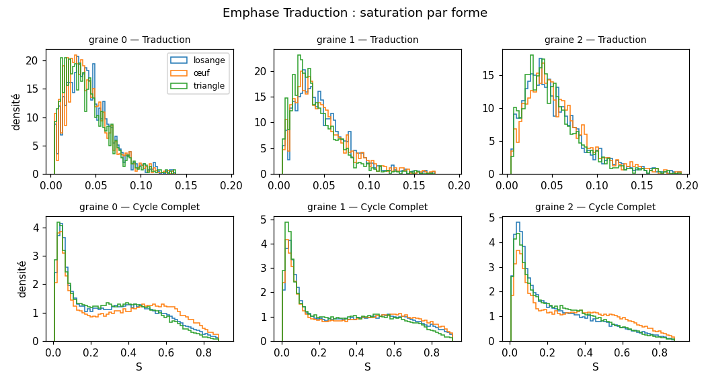
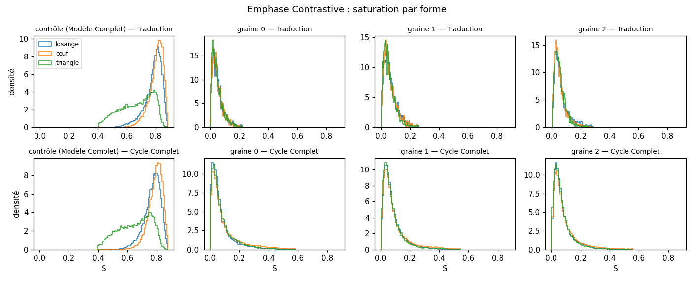
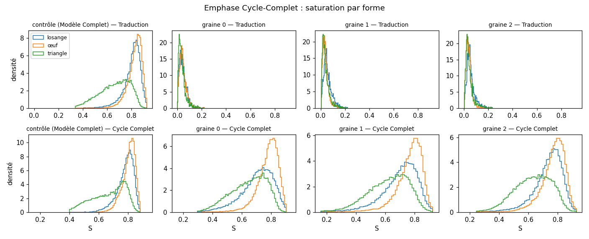
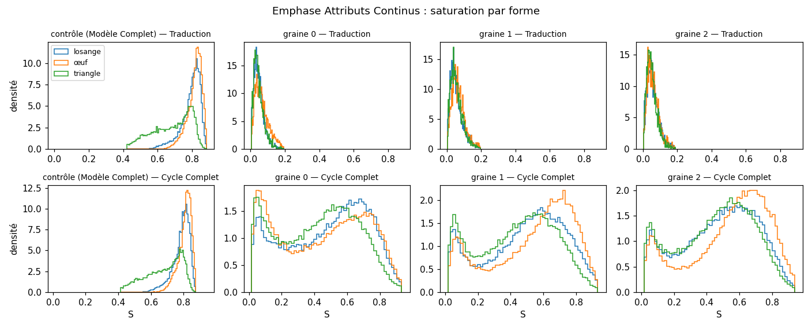

**Figure 4 — Distribution de S par forme, en traduction (ligne du haut) et en cycle complet (ligne du
bas), valeurs approchées** ; mêmes panneaux qu'en figure 3. En cycle complet, Emphase Cycle-Complet
restitue des couleurs saturées pour les trois formes et toutes les instances (pics vers 0,7–0,8,
comme le contrôle) ; Référence, Emphase Traduction et Emphase Attributs Continus mêlent des images
saturées et des images grises ; Emphase Contrastive les ramène presque toutes au gris.

### 3.3 Régularité, arbitraire et comparaisons multiples

**Saturation (traduction, valeurs exactes).** Sans bruit, S diffère entre orientations dans toutes les
instances des 5 configurations (test de [1] et critère d'effet ; |δ| maximal 0,27 à 0,45), contre aucune
paire chez les contrôles avec le test de [1] et 1 % des paires d'un contrôle sur 4 avec le critère
d'effet. Avec le bruit, S diffère entre formes dans toutes les instances de Référence, Emphase
Cycle-Complet et Emphase Attributs Continus, avec des profils propres à chaque instance (|δ| entre
instances jusqu'à 1,00). Pour la forme et la taille, les contrôles diffèrent aussi (triangles et petites
formes moins saturés, § 3.1) : seule la partie propre à chaque instance est interprétable.

**Teinte : effet de la correction pour comparaisons multiples** (unité : la paire de catégories ;
famille : toutes les paires d'un tableau ; tableaux complets en annexe B.3).

| % d'instances régulières | Teinte, orientation, traduction : test [1] → Holm ; critère d'effet | Teinte, forme, traduction bruitée : test [1] → Holm ; critère d'effet |
|---|---|---|
| Référence | 100 → 33 ; 100 | 100 → 67 ; 100 |
| Emphase Traduction | 0 → 0 ; 100 | 0 → 0 ; 33 |
| Emphase Contrastive | 0 → 0 ; 100 | 0 → 0 ; 0 |
| Emphase Cycle-Complet | 100 → 33 ; 100 | 33 → 33 ; 67 |
| Emphase Attributs Continus | 100 → 33 ; 100 | 100 → 67 ; 100 |
| Contrôles (4) | 0 → 0 ; 0 | 0 → 0 ; 0 |

- Le **test de [1]** perd l'essentiel de ses résultats après correction de Holm : la régularité de la
  teinte selon l'orientation ne subsiste que dans 1 instance sur 3 (avec une seule paire significative
  dans certaines). Benjamini-Hochberg en conserve davantage.
- Le **KS sur valeurs brutes** est significatif partout, contrôles compris (9 600 à 51 200 traductions
  par catégorie) : inutilisable seul.
- Le **critère d'effet** ne bouge pas sous correction (p ≈ 0) et sépare les modèles des contrôles : la
  teinte varie avec l'orientation dans toutes les instances des 5 configurations, dans aucun contrôle.
  Les effets sont petits (4 à 48 % des paires selon la configuration) et portent, sans bruit, sur des
  couleurs presque grises.
- **Arbitraire de la teinte** (traduction bruitée, même forme, paires d'instances qui diffèrent) :
  Référence 89 % → 33 % après Holm (critère d'effet 89 %), Emphase Cycle-Complet 100 % → 78 % (100 %),
  Emphase Attributs Continus 89 % → 78 % (78 %) ; Emphase Traduction et Emphase Contrastive 0 % au
  test de [1].

### 3.4 Intervention sur la masse résiduelle de forme

**Protocole.** Chemin de traduction ; on ne modifie que le vecteur de forme (one-hot + ε·u, § 2.3) ;
le modèle est déterministe, donc sur un exemple donné l'écart observé est l'effet de cette seule
modification. Les directions **admissibles** (240° à 300° dans le plan tangent) gardent le vecteur dans
le simplexe : la forme cible perd 0,71 ε à 0,82 ε de masse au profit des deux autres (à 240°, tout part
vers l'une ; à 300°, tout vers l'autre). 48 exemples (3 formes × 4 orientations × 2 tailles × 2
positions) × 36 directions × 9 amplitudes, pour les 19 modèles. Témoin de spécificité : même norme ε
appliquée aux 5 attributs continus (36 directions aléatoires). Unité statistique : l'exemple (valeur
médiane sur les 7 directions admissibles) ; tests de Wilcoxon appariés, correction de Holm ; détail en
annexe A.

| Instance | S sans bruit | S, ε = 0,001 [IC 95 %] | S, ε = 0,01 [IC 95 %] | colorés (S ≥ 0,3), ε = 0,01 | ΔC forme / ΔC continus, ε = 0,001 [IC 95 %] |
|---|---|---|---|---|---|
| Référence graine 0 | 0,05 | 0,07 [0,05–0,09] | 0,10 [0,06–0,30] | 17/48 | 2,2 [1,5–12,0] |
| Référence graine 1 | 0,05 | 0,23 [0,19–0,27] | 0,71 [0,66–0,76] | 48/48 | 118 [93–134] |
| Référence graine 2 | 0,06 | 0,45 [0,42–0,49] | 0,81 [0,78–0,84] | 48/48 | 166 [134–176] |
| Emphase Cycle-Complet graine 0 | 0,03 | 0,24 [0,17–0,40] | 0,81 [0,76–0,88] | 48/48 | 133 [118–152] |
| Emphase Cycle-Complet graine 1 | 0,03 | 0,04 [0,03–0,06] | 0,85 [0,79–0,90] | 46/48 | 84 [64–118] |
| Emphase Cycle-Complet graine 2 | 0,03 | 0,04 [0,04–0,06] | 0,59 [0,46–0,68] | 39/48 | 85 [67–103] |
| Emphase Attributs Continus graine 0 | 0,05 | 0,09 [0,07–0,13] | 0,50 [0,37–0,60] | 34/48 | 10 [8–16] |
| Emphase Attributs Continus graine 1 | 0,05 | 0,38 [0,31–0,41] | 0,75 [0,71–0,78] | 48/48 | 108 [83–120] |
| Emphase Attributs Continus graine 2 | 0,05 | 0,30 [0,27–0,33] | 0,93 [0,89–0,95] | 48/48 | 95 [88–113] |
| Emphase Traduction (3 graines) | 0,04–0,05 | 0,04–0,05 | 0,04–0,06 | 0/48 | 0,6 à 2,1 |
| Emphase Contrastive (3 graines) | 0,04–0,06 | 0,04–0,06 | 0,05 | 0 à 3/48 | 0,4 à 1,1 |
| Contrôles (4) | 0,80–0,83 | 0,80–0,83 | 0,80–0,83 | 48/48 | 0,5 à 56 |

ε = 0,001 correspond à 0,07–0,08 % de masse déplacée, ε = 0,01 à 0,7–0,8 %. ΔC : déplacement de la
couleur dans le plan de chrominance, médiane par exemple, rapport des deux perturbations de même norme.

- **Effet** : dans 8 des 9 instances des trois configurations qui répondent, S passe de 0,03–0,06 à
  0,50–0,93 à ε = 0,01 (34 à 48 exemples colorés sur 48 ; p < 10⁻⁴ après correction sur 57 tests).
  **Dose-réponse** : S croît avec ε pour 45 à 48 exemples sur 48 (ρ de Spearman médian par exemple :
  0,91 à 1,00). Dès ε = 0,001, la médiane atteint S ≥ 0,3 dans 2 instances.
- **Exception** : Référence graine 0 ne répond presque pas, sauf pour les losanges.
- **Spécificité** : à norme égale, perturber les attributs continus déplace la couleur 10 à 166 fois
  moins (borne basse des IC ≥ 7,8), sauf chez Référence graine 0 (2,2).
- **Témoins** : la saturation des contrôles ne change pas (écart ≤ 0,01). Emphase Traduction et
  Emphase Contrastive restent grises ; quelques p y sont faibles mais l'effet est négligeable
  (ΔS ≤ 0,01), d'où l'usage des tailles d'effet.
- **Réserve** : chez le contrôle d'Emphase Cycle-Complet, le résidu déplace aussi la couleur (ΔC = 32
  à ε = 0,01) sans changer S : la sensibilité au résidu de forme est en partie une propriété de cette
  configuration, indépendamment de l'absence de couleur.
- **Plage réaliste** : sur 19 200 vraies images, le décodeur d'attributs produit lui-même un résidu de
  forme de cette taille : médiane 0,4 à 1 % chez Emphase Cycle-Complet (et son contrôle) ; médiane 0,01
  à 0,02 %, mais 25 à 31 % des images au-delà de 0,07 %, chez Référence et Emphase Attributs Continus ;
  résidu quasi nul chez Emphase Traduction et Emphase Contrastive.
- **Forme reconnue** : l'image traduite, ré-encodée, est reconnue comme la bonne forme dans 95 à 100 %
  des cas jusqu'à ε = 0,01 dans les directions admissibles (sauf Emphase Cycle-Complet graine 1 : 72 % ;
  son contrôle : 85 %).

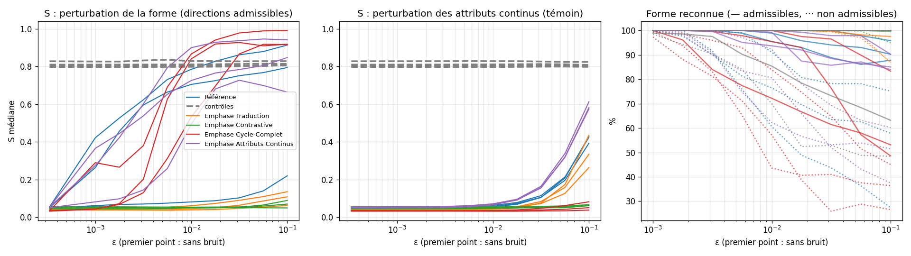

**Figure 5 — Saturation et reconnaissance de la forme selon l'amplitude ε de la perturbation.** Une
courbe par instance, couleur par configuration (tirets gris : contrôles) ; premier point : sans
perturbation. Gauche : perturbation de la forme (directions admissibles), médiane de S. Les instances de
Référence (sauf la graine 0), d'Emphase Cycle-Complet et d'Emphase Attributs Continus passent du gris à
S = 0,6–0,9 entre ε = 0,001 et 0,01 ; Emphase Traduction et Emphase Contrastive restent sous 0,15 ; les
contrôles restent à 0,80–0,83. Centre : même perturbation sur les attributs continus ; S ne bouge pas
avant ε ≈ 0,02, puis monte jusqu'à 0,6 à ε = 0,1 (l'orientation sort alors du cercle unité : ce témoin ne
vaut qu'aux petites amplitudes). Droite : forme reconnue après ré-encodage (traits pleins : directions
admissibles ; pointillés : non admissibles, qui donnent des probabilités négatives jamais vues à
l'entraînement).

<b>Figure 6 — Direction du déplacement de la couleur dans le plan de chrominance (5 configurations)</b>

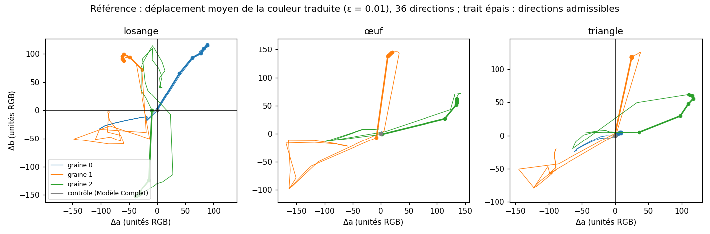
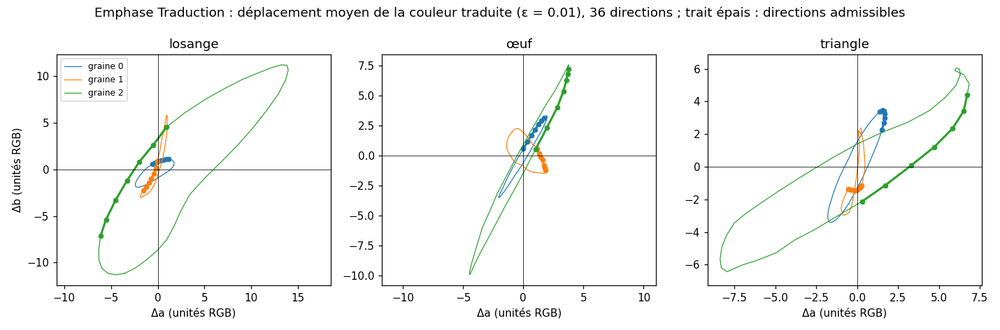
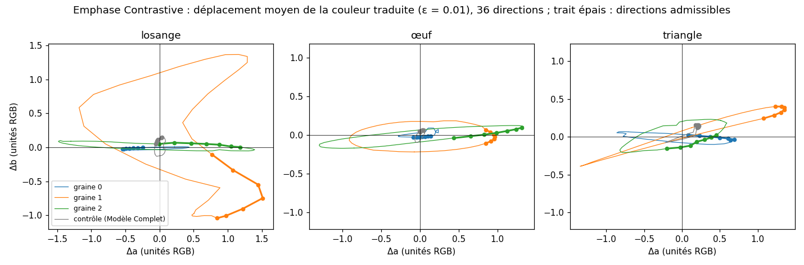
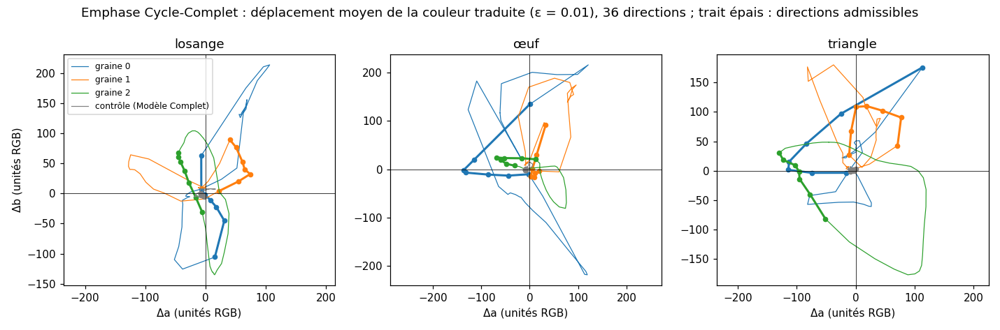
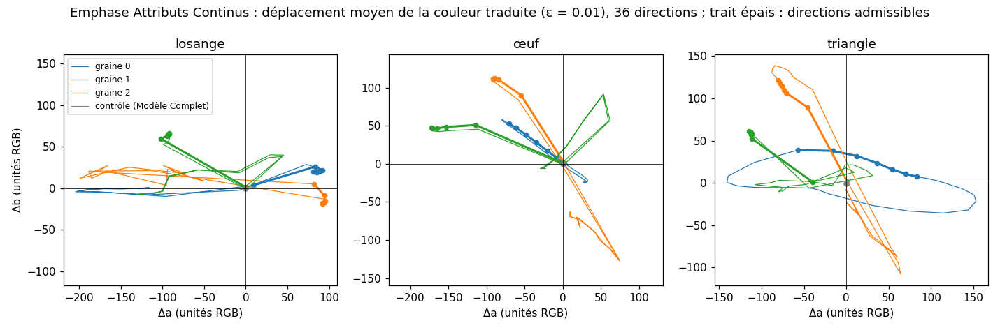

**Figure 6 — Où va la couleur quand on perturbe la forme : déplacement moyen (Δa, Δb) de la couleur
traduite à ε = 0,01, pour les 36 directions de perturbation** (a : Référence, b : Emphase Traduction,
c : Emphase Contrastive, d : Emphase Cycle-Complet, e : Emphase Attributs Continus ; un panneau par
forme ; moyenne sur les 16 exemples de la forme). Chaque courbe fermée parcourt les 36 directions ; le
trait épais et les points marquent les 7 directions admissibles (de 240° à 300°). **Attention aux
échelles** : ±150 à ±200 unités RGB pour Référence, Emphase Cycle-Complet et Emphase Attributs Continus,
±10 pour Emphase Traduction, ±1,5 pour Emphase Contrastive. Lecture :

- Dans les trois configurations qui répondent, la couleur s'éloigne du gris de 50 à 200 unités, dans
  une **direction propre à chaque instance** (les trois graines partent dans des directions
  différentes : arbitraire) et **propre à chaque forme** (régularité). Les contrôles (gris) restent près
  de l'origine.
- Le long du trait épais, la couleur se déplace quand la masse passe d'une forme non cible à l'autre :
  sur de grands arcs chez Emphase Cycle-Complet et Emphase Attributs Continus graine 0 (la teinte
  dépend fortement de la direction) ; chez Référence et Emphase Attributs Continus graines 1 et 2, les
  points restent souvent groupés (dépendance plus faible), avec parfois un saut entre deux directions
  voisines.
- Chez Emphase Traduction et Emphase Contrastive, le déplacement existe mais est 10 à 100 fois plus
  petit : la traduction reste grise quelle que soit la direction.

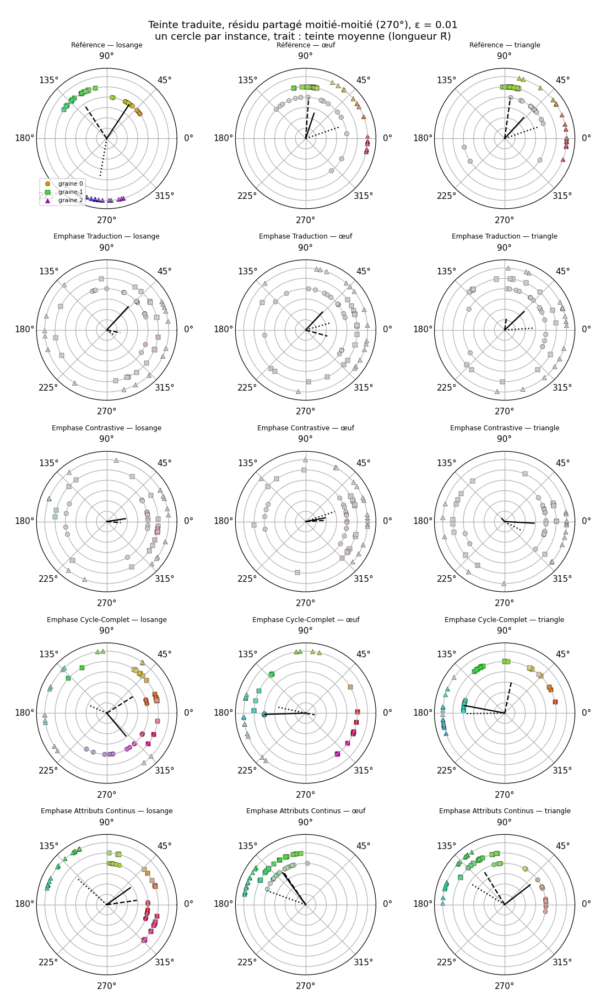

**Figure 7 — Teinte traduite de chaque exemple, résidu partagé moitié-moitié entre les deux formes non
cibles (270°), ε = 0,01.** Une ligne par configuration, une colonne par forme ; angle : teinte ; un
cercle par instance (cercle intérieur : graine 0 ; marqueurs rond, carré, triangle : graines 0, 1, 2) ;
couleur des marqueurs : couleur réellement produite ; traits noirs : teinte moyenne de chaque instance,
de longueur R̄ (1 : tous les exemples ont la même teinte). Chez Référence, Emphase Cycle-Complet et
Emphase Attributs Continus, chaque instance regroupe ses exemples autour d'une teinte qui lui est
propre (ex. losanges de Référence : 57°, 124° et 260° selon la graine, R̄ ≥ 0,96 ; différence entre
instances : test de permutation, p ≤ 0,04 pour chaque forme et chaque direction testée). Chez Emphase
Traduction et Emphase Contrastive, les marqueurs sont gris et dispersés.

**Teinte selon la direction du résidu** (ε = 0,01 ; seuls les exemples colorés aux deux extrêmes,
S ≥ 0,3, car la teinte d'un gris n'a pas de sens ; plancher de mesure : 99e centile de l'écart chez les
contrôles, 15°) :

- **forte dépendance** : Emphase Cycle-Complet, 3 instances sur 3 (écart médian entre les deux extrêmes
  de 65° à 156°, 100 % des exemples au-dessus du plancher, n = 16 à 43) et Emphase Attributs Continus
  graine 0 (140°, 8/8) ;
- **faible dépendance** : Référence graine 1 (18°, 6/11 au-dessus du plancher) et Emphase Attributs
  Continus graine 1 (16°, 8/16) ; Référence graine 2 et Emphase Attributs Continus graine 2 n'ont que 2
  et 3 exemples colorés aux deux extrêmes (avec S ≥ 0,15 : 27° et 14°) ;
- **non testable** : Référence graine 0, Emphase Traduction, Emphase Contrastive (pas d'exemples
  colorés) ;
- la variation **n'est pas continue** : entre deux directions voisines (10°), le plus grand saut atteint
  74° en médiane (Emphase Cycle-Complet graine 0), et la teinte ne varie dans un seul sens que dans 25 à
  82 % des exemples.

### 3.5 Associations forme → couleur

Avec le bruit de la traduction bruitée (§ 2.3), on décrit chaque modèle et chaque forme par sa teinte
dominante et sa constance sur les 51 200 traductions de la forme.

- 7 modèles sur 15 ont au moins une association de constance ≥ 60 % (16 associations ; 15 si l'on exige
  que la borne basse de l'IC de Wilson dépasse 60 %) : Référence graines 0 à 2, Emphase Attributs
  Continus graines 1 et 2, Emphase Cycle-Complet graines 0 et 2.
- Les plus constantes : œufs turquoise (Emphase Attributs Continus graine 2, 95 %), œufs cyan clair
  (Emphase Cycle-Complet graine 0, 92 %), œufs et triangles vert-jaune (Référence graine 1, 88 et 87 %).
  Seul bleu : les losanges de Référence graine 2 (bleu-violet, 79 %). Aucun triangle rouge.
- Sans bruit, tout est gris ; Emphase Traduction et Emphase Contrastive restent grises avec le bruit.

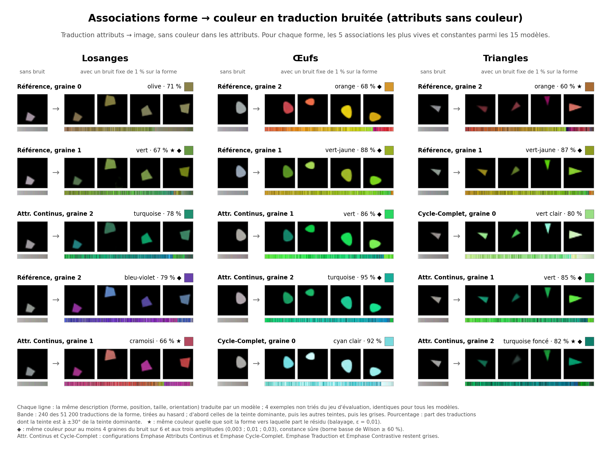

**Figure 8 — Les associations forme → couleur les plus nettes.** Pour chaque forme, les 5 associations
les plus saturées et constantes parmi les 15 modèles. Chaque ligne : la même description (forme,
position, taille, orientation) traduite par le modèle indiqué, sans bruit (à gauche, toujours grise) puis
avec le bruit (4 exemples non triés, identiques pour tous les modèles) ; bande : 240 des 51 200
traductions de la forme (teinte dominante, puis autres teintes, puis gris) ; pourcentage : constance.
★ : même couleur quelle que soit la forme non cible qui reçoit le résidu (§ 3.4) ; ◆ : même couleur pour
au moins 4 graines de bruit sur 6 et aux trois amplitudes (§ 3.7). Deux associations ont ★ et ◆ :
losanges verts de Référence graine 1, triangles turquoise foncé d'Emphase Attributs Continus graine 2.

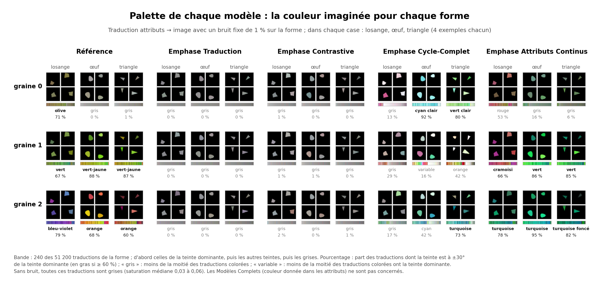

**Figure 9 — Palette de chacun des 15 modèles sans couleur.** Colonnes : configurations et formes ;
lignes : graines ; dans chaque case, 4 traductions bruitées, la bande des 240 traductions, le nom de la
couleur dominante et sa constance (en gras si ≥ 60 %). « gris » : moins de la moitié des traductions
colorées ; « variable » : moins de la moitié des traductions colorées ont la teinte dominante. On y lit
la **régularité** (au sein d'un modèle, la couleur dépend de la forme : Référence graine 2, losanges
bleu-violet et œufs orange) et l'**arbitraire** (d'une graine à l'autre, la couleur change : losanges
olive, verts ou bleu-violet selon la graine de Référence).

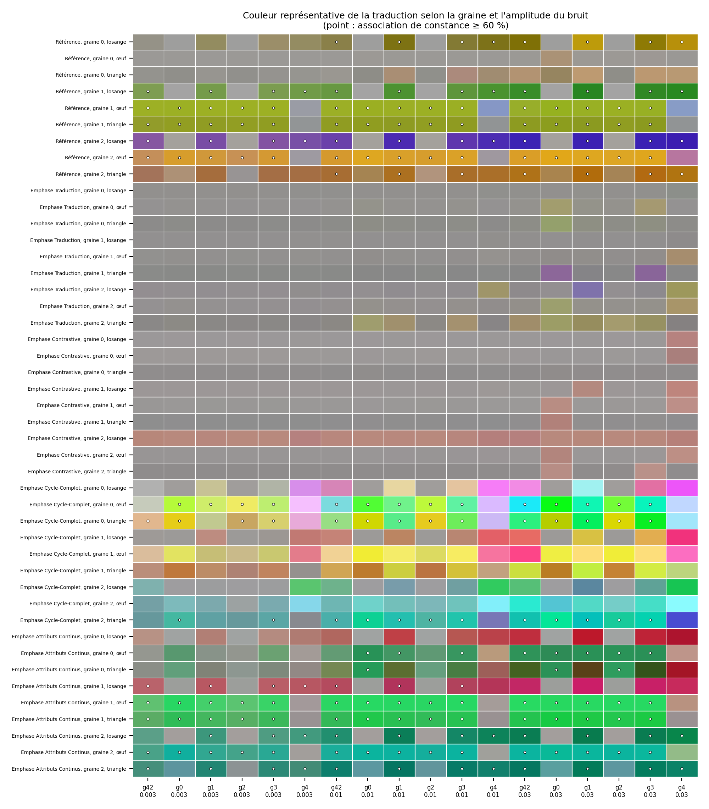

**Figure 10 — Couleur représentative de chaque modèle et de chaque forme selon le bruit.** Lignes : les
45 couples modèle × forme ; colonnes : graine du vecteur de bruit (42, celle de [1], puis 0 à 4) et
amplitude (0,003 ; 0,01 ; 0,03) ; point : association sûre (borne basse de Wilson de la constance
≥ 60 %). Les mêmes trois configurations se colorent quels que soient la graine et l'amplitude ; Emphase
Traduction et Emphase Contrastive restent grises. Une ligne de couleur uniforme avec des points presque
partout est une association stable (œufs et triangles de Référence graine 1, œufs et triangles
d'Emphase Attributs Continus graines 1 et 2 : seule la graine 4 les fait perdre). Les cases grises ou
d'une autre couleur au milieu d'une ligne correspondent le plus souvent aux graines où le résidu part
vers une autre forme non cible. Emphase Cycle-Complet graine 0
change de couleur selon la graine (œufs : de −35° à −101°).

**Stabilité selon la direction du bruit.** Le vecteur de bruit étant le même pour toutes les images, sa
graine fixe une direction de résidu. Nombre d'associations sûres à l'amplitude 0,01 : 15, 11, 15, 9, 16
et 5 sur 45 selon la graine (graine 4 : la seule où le résidu du losange et de l'œuf part vers le
triangle). Des 15 associations sûres avec la graine 42, aucune ne reste sûre avec la même couleur pour
les 5 autres graines ; 12 le restent pour au moins 3 autres graines, et **9 pour au moins 3 autres
graines et aux deux autres amplitudes** : losanges verts, œufs et triangles vert-jaune de Référence
graine 1 ; losanges bleu-violet et œufs orange de Référence graine 2 ; œufs et triangles verts
d'Emphase Attributs Continus graine 1 ; œufs turquoise et triangles turquoise foncé d'Emphase Attributs
Continus graine 2. Quand une association se perd, la forme redevient surtout grise ou peu constante ;
elle change rarement de couleur (écart de teinte dominante entre graines : médiane 1°, 104 paires),
sauf chez Emphase Cycle-Complet graine 0.

### 3.6 La couleur d'entrée est lisible dans les attributs décodés

**Protocole.** 19 200 images (32 par case teinte × forme × taille), image → VAE → GW → décodeur
d'attributs, pour les 19 modèles. On prédit la couleur d'entrée (chrominance a, b) à partir de :

- le **résidu** des probabilités de forme (log-rapports des deux formes non cibles à la forme cible) ;
- les **écarts des 5 attributs continus** décodés à leurs vraies valeurs ;
- les deux ensemble (« tout »), avec les vraies valeurs des attributs (la géométrie), qui seules ne
  prédisent rien (R² ≤ 0).

Régressions ridge, k plus proches voisins et petit perceptron (2 couches de 64 unités), un modèle par
forme cible ; R² en validation croisée à 5 plis, meilleure des trois. Ligne de base à couleurs
mélangées : R² entre −0,017 et 0,000. Repère : la couleur lue directement dans le latent du GW.

| R² de la chrominance (moyenne des 3 graines) | résidu | continus | continus + géométrie | tout | latent GW | transmission en cycle complet R̄ |
|---|---|---|---|---|---|---|
| Référence | 0,36 | 0,16 | 0,60 | 0,83 | 0,95 | 0,79 |
| Emphase Traduction | 0,07 | 0,06 | 0,52 | 0,59 | 0,94 | 0,54 |
| Emphase Contrastive | 0,00 | 0,06 | 0,24 | 0,25 | 0,29 | 0,18 |
| Emphase Cycle-Complet | 0,65 (0,42 à 0,96) | 0,22 | 0,55 | 0,96 | 0,99 | 0,99 |
| Emphase Attributs Continus | 0,40 | 0,10 | 0,58 | 0,90 | 0,96 | 0,84 |
| Contrôles (4) | ≤ 0,02 | ≤ 0,07 | ≤ 0,13 | ≤ 0,15 | 1,00 | – |

- La couleur est **lisible** dans 4 configurations sur 5, alors que les attributs n'en contiennent pas ;
  les contrôles, qui n'ont aucune raison de la cacher, plafonnent à 0,15.
- Le **résidu seul** n'en porte l'essentiel que pour Emphase Cycle-Complet graine 0 (0,96) ; une partie
  pour Référence, Emphase Attributs Continus et Emphase Cycle-Complet graines 1 et 2 (0,24 à 0,56) ;
  presque rien pour Emphase Traduction (≤ 0,09), et rien pour Emphase Contrastive. Le reste passe par
  les **écarts des attributs continus**, lisibles seulement avec la géométrie : le code couleur y dépend
  de la forme, de la taille, de la position ou de l'orientation.
- **Emphase Contrastive** a déjà perdu l'essentiel de la couleur dans l'espace de travail (latent :
  0,29). Ailleurs, le latent la contient (0,94 à 0,99) et c'est le décodeur d'attributs qui en laisse
  passer plus ou moins.
- Ce qui est lisible **classe les modèles comme la transmission en cycle complet** (ρ de Spearman 0,96
  pour le résidu seul, 0,99 pour « tout », 15 modèles ; R̄ par instance et forme : Emphase Cycle-Complet
  0,97 à 1,00 ; Emphase Attributs Continus 0,76 à 0,90 ; Référence 0,64 à 0,88 ; Emphase Traduction
  0,50 à 0,57 ; Emphase Contrastive 0,14 à 0,27).
- **Luminosité** : la seule luminosité qui varie dans ces données, I = (R + G + B)/3, ne dépend que de
  la teinte et n'est lue que de façon non linéaire (« tout » : 0,77 en moyenne pour Emphase
  Cycle-Complet).

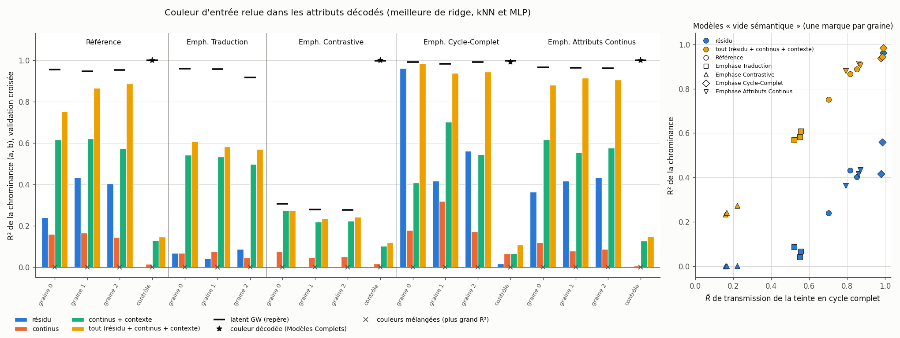

**Figure 11 — Part de la couleur d'entrée relue dans les attributs décodés.** Gauche : R² de la
chrominance par modèle (meilleure des trois régressions, validation croisée) pour chaque groupe de
variables (bleu : résidu ; rouge : écarts des continus ; vert : continus + géométrie ; jaune : tout) ;
trait noir : couleur lue dans le latent du GW ; étoile : couleur décodée par les contrôles ; croix : plus
grand R² à couleurs mélangées (≈ 0). Droite : R² du résidu (bleu) et de « tout » (jaune) contre la
transmission de la teinte en cycle complet R̄, une marque par instance (forme du marqueur :
configuration). Les deux croissent ensemble ; « tout » est presque toujours au-dessus du résidu seul.

### 3.7 Robustesse

Volets mesurés sur le chemin de traduction (4 608 attributs tirés du jeu d'évaluation, les mêmes pour
tous les modèles et toutes les conditions, donc comparaisons appariées) et sur la régression ; détail en
annexe B.

| Volet | Résultat | Verdict |
|---|---|---|
| Autre extraction (pixel le plus intérieur du masque) | ΔS médian par modèle −0,000 à +0,005 ; les 15 associations sûres sont les mêmes (constances à ±2 points, teintes dominantes identiques) ; arbitraire de S inchangé ; l'effet de mesure chez les contrôles diminue (|δ| maximal entre formes 0,73–0,81 → 0,58–0,64) sans disparaître | tient |
| Graine et amplitude du bruit (6 graines × 0,003 ; 0,01 ; 0,03) | les mêmes 3 configurations se colorent (S médiane à 0,01 : Référence 0,24–0,48, Emphase Cycle-Complet 0,40–0,58, Emphase Attributs Continus 0,29–0,64 selon la graine) ; Emphase Traduction et Emphase Contrastive ≤ 0,06 | tient |
| Associations forme → couleur selon la graine du bruit | 9 sur 15 stables pour ≥ 4 graines sur 6 et 3 amplitudes ; aucune pour les 6 graines (§ 3.5) | tient en partie |
| Correction pour comparaisons multiples | test de [1] fragile ; critère d'effet inchangé (§ 3.3) | dépend du test |
| Régression : autre tirage d'images (graines 1 et 2) | R² changés de 0,01 au plus ; classement des 15 modèles conservé (ρ 0,98 à 1,00) | tient |
| Régression : nombre d'images (16, 32, 64 par case) | résidu seul stable (± 0,02) ; les R² qui demandent la géométrie (kNN) croissent avec n (« tout » : −0,07 à 16 par case, +0,09 à 64), contrôles compris (≤ 0,28) | valeurs absolues = bornes basses |
| Autres instances ou réentraînements | hors de portée sur le matériel utilisé | non fait |

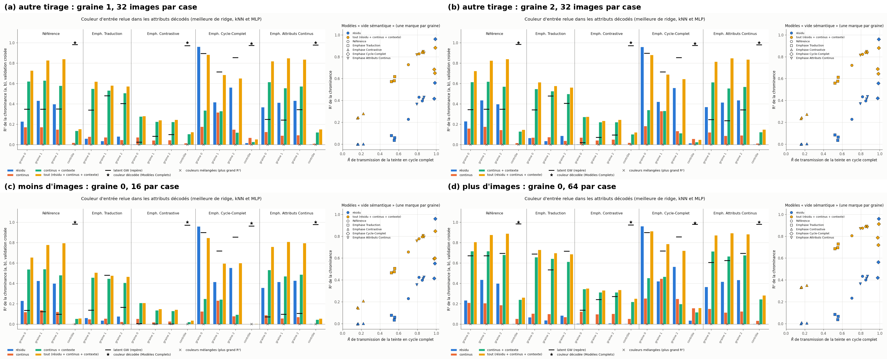

**Figure 12 — Régression refaite sur d'autres sous-ensembles d'images** (même présentation que la
figure 11) : (a, b) autres tirages, graines 1 et 2, 32 images par case ; (c, d) graine 0 avec 16 et 64
images par case. Ces variantes n'utilisent que ridge et kNN (le perceptron coûte environ 1 h par
variante) : le repère « latent GW » y est très sous-estimé (0,1 à 0,9 au lieu de 0,94 à 0,99), car ces
deux régressions lisent mal un espace de 12 dimensions ; c'est la comparaison entre panneaux qui compte.
Le R² du résidu (bleu) est le même dans les quatre panneaux ; « continus + géométrie » et « tout »
augmentent avec le nombre d'images, et l'écart aux contrôles comme le classement des modèles restent
les mêmes.

## 4. Discussion

**Ce que montrent les données.** Les modèles sans couleur gardent la couleur de l'image dans leur
espace de travail (latent : R² de 0,94 à 0,99, sauf Emphase Contrastive), et leur décodeur d'attributs
en laisse filtrer une partie dans des sorties censées ne pas la contenir : de petites masses de
probabilité sur les formes non cibles et de petits écarts des attributs continus. En traduction à partir
d'attributs « propres » (one-hot exact), ce canal est vide et l'image est grise ; un résidu de 0,1 à
1 % suffit à produire une couleur saturée. Cette couleur dépend de la forme (régularité), de l'instance
(arbitraire) et de la direction du résidu. L'ensemble est **cohérent avec l'hypothèse** que ces modèles
codent la couleur dans les détails des attributs décodés, que le cycle complet exploite (ce qui est
lisible prédit ce qui est restitué, ρ = 0,99) et que la traduction bruitée décode comme un code couleur.
Nous n'avons pas montré que le GW **lit** les écarts des attributs continus : une perturbation aléatoire
de ces attributs déplace peu la couleur (§ 3.4) ; il faudrait les perturber selon les directions qui
portent la couleur.

**Les configurations diffèrent.** Emphase Cycle-Complet transmet presque toute la couleur par les
attributs (R̄ ≈ 1) et sa traduction est très sensible au résidu, contrôle compris. Emphase Traduction
produit un résidu de forme quasi nul : sa couleur passe par les attributs continus (R² 0,52 avec la
géométrie) et sa traduction reste grise quel que soit le résidu. Emphase Contrastive perd la couleur
dès l'espace de travail.

**Portée pour les résultats de [1].** Les régularités de teinte en traduction sans bruit portent sur
des couleurs presque grises ; elles existent (critère d'effet, absentes des contrôles) mais sont
petites, et le test de [1] ne les retient plus après correction pour comparaisons multiples. Avec le
bruit, les associations forme → couleur sont nettes et visibles (figures 8 et 9), mais leur couleur
dépend de la direction du bruit utilisé ; les affirmations du type « ce modèle voit les X en Y » ne
valent que pour une direction donnée, sauf pour les 9 associations stables, et les 2 qui résistent aux
deux tests.

**Limites.**

- 3 instances par configuration : toute généralisation à une configuration repose sur ce nombre
  (Référence graine 0 se comporte autrement que les graines 1 et 2).
- Contrôle d'Emphase Traduction indisponible ; contrôles entraînés plus brièvement (147 000 à 294 000
  pas) que les modèles sans couleur.
- S approchée pour le demi-cycle et le cycle complet (RGB arrondis ; erreur médiane < 0,005).
- Mesure de la couleur sur un patch central : effet de mesure pour les triangles et les petites
  formes, à contrôler à chaque comparaison.
- Un seul jeu de données (formes simples, teintes à S et L fixes).
- R² des régressions qui demandent la géométrie : bornes basses (ils croissent avec le nombre
  d'images).

## 5. Reste à faire

- **Le GW lit-il les écarts des attributs continus ?** Perturber les continus selon les directions qui
  portent la couleur (propres à chaque géométrie), puis mesurer la couleur traduite et celle du cycle
  complet.
- **Plus d'instances** par configuration, et le contrôle d'Emphase Traduction (§ 6).
- Mêmes statistiques (IC, tailles d'effet, correction) pour la saturation en demi-cycle et en cycle
  complet, avec une évaluation exacte de S (environ 35 min par modèle sur le GPU utilisé).
- Perceptron sur les variantes de la régression, pour des R² comparables au § 3.6.

## 6. Reproductibilité

**Scripts** (tous dans `experiments/`, sauf l'évaluation ; aucune modification du comportement par
défaut du code existant, tout passe par des options) :

| Étape | Commande | Sortie (`results/saturation/`) |
|---|---|---|
| Évaluation exacte H, S, L de la traduction, avec et sans bruit | `bash scripts/evaluate_saturation.sh --translation-only --low-memory` (appelle `SSD_eval/SSD_eval_arbitrary.py` et `SSD_eval_regularity.py` avec `--hls`, sans bruit et avec `--shape-noise 0.01 --shape-noise-seed 42`) | `traduction_seule/` |
| Témoin de mesure | `saturation_reference.py` | `temoin/` |
| Analyse S, L, régularité, arbitraire ; figures 1 à 4 | `saturation_analysis.py [--from-rgb] [--figures-only]` | `traduction_seule/analysis/`, `apercu_chapitre3/` |
| Tableaux par canal et par test | `make_tables.py --channel H/S/L --test binned/raw` | `traduction_seule/tableaux_*` |
| Intervention sur la forme ; figures 5 à 7 | `shape_noise_sweep.py [--analyze-only]` | `balayage/` |
| Statistiques de l'intervention (annexe A) | `sweep_statistics.py` | `balayage/statistiques.md` |
| Associations ; figures 8 et 9 | `synesthesia_figure.py` | `synesthesie/` |
| Régression ; figure 11 | `residual_regression.py` | `regression/` |
| Robustesse (annexe B) ; figures 10 et 12 | `saturation_robustness.py`, `multiple_testing.py`, `regression_sensitivity.py`, `robustness_statistics.py` | `robustesse/` |

Environnement, données et durées : README du dépôt (§ 2 « Saturation et luminosité »). Sur un GeForce
940MX : évaluation complète environ 35 min par modèle, traduction seule environ 10 min, régression
environ 1 h 10 pour les 19 modèles.

L'évaluation produit aussi, pour chaque modèle, les cartes de chaleur standard de régularité par
attribut et par canal (environ 6 200 fichiers dans `arbitrary/` et `traduction_seule/`) ; elles ne
sont pas reproduites ici, les figures et tableaux ci-dessus en résument le contenu.

**Contrôle manquant.** Le modèle de contrôle de la configuration Emphase Traduction
(`epoch=599.ckpt`, run W&B `2eeamagz`, 145 800 pas) n'est plus disponible localement : la seule copie
trouvée est tronquée (2,75 Mio, sans poids du GW). L'original se trouve sur la machine d'entraînement
(`/home/alexis/Desktop/checkpoints/training_logs/Removing_colors/(Colored) H_T (10) v5/checkpoints/`,
fichiers `epoch=599.ckpt` ou `last-v2.ckpt`). L'archive publiée (Zenodo, DOI 10.5281/zenodo.24208192)
contient à sa place un autre entraînement du même dossier, lancé sans perte de traduction effective.
Pour la remplacer : `scripts/identify_checkpoints.py <dossier>`, puis
`scripts/package_checkpoints.py --located located_checkpoints.yaml`, puis sur Zenodo « New version »
du record 24208192 avec la nouvelle archive, et mise à jour de `ZENODO_RECORD`
(`scripts/download_checkpoints.sh`), du DOI du README et de `experiments/thesis_runs.yaml`.
Réentraîner donnerait un modèle différent, et le jeu d'entraînement local est incomplet.

## Références

1. Emanuelli, A. (2025). *Définition et émergence d'une synesthésie artificielle dans un modèle
   d'apprentissage profond inspiré de la théorie du Global Workspace* [Mémoire de M2].
2. Devillers, B., Maytié, L., VanRullen, R. (2024). *Semi-supervised multimodal representation
   learning through a global workspace.*
3. VanRullen, R., Kanai, R. (2021). *Deep learning and the Global Workspace Theory.*

## Annexes

- [Annexe A](annexes/A_statistiques_balayage.md) : statistiques complètes de l'intervention sur la forme
  (dose-réponse, spécificité, résidus réels, dépendance à la direction).
- [Annexe B](annexes/B_robustesse.md) : robustesse (extraction, graines et amplitudes du bruit,
  comparaisons multiples, sous-ensembles de la régression).

Dans les annexes, « mémoire » désigne les réglages et le test de [1] (KS sur histogrammes à 15 classes ;
vecteur de bruit de graine 42, amplitude 0,01) ; « annexe E » désigne cette traduction bruitée.
