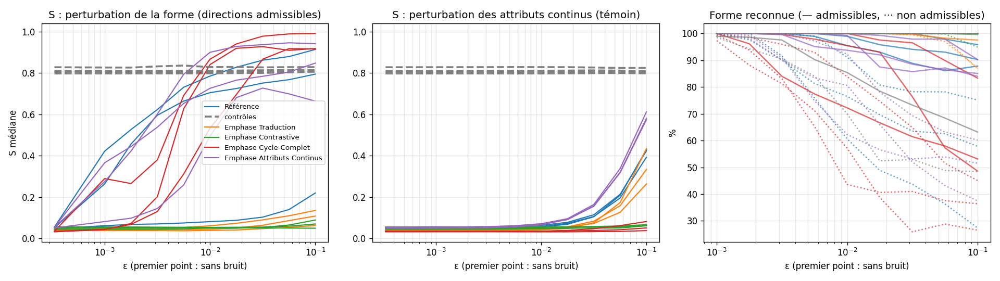
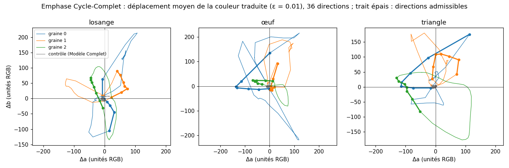

# Un code couleur caché dans les attributs : le mécanisme d'une synesthésie artificielle dans un Global Workspace

*Brouillon d'article — branche `publication`. Figures : `paper/figures/` ; supplément :
[`paper/supplementaire/`](supplementaire/README.md).*

## Résumé

Un Global Workspace (GW) bimodal apprend à relier des images de formes simples et un vecteur
d'attributs (forme, taille, position, orientation). Lorsque la couleur est absente des attributs, le
modèle doit l'inventer pour traduire des attributs en image ; des travaux antérieurs y ont décrit des
associations forme → couleur propres à chaque modèle, analogues à une synesthésie [1]. Nous montrons
que ces couleurs ne sont pas inventées à partir de rien. **Le décodeur d'attributs cache la couleur de
l'image dans ses sorties**, principalement dans une infime masse de probabilité (0,01 à 1 %) attribuée
aux formes absentes, et secondairement dans de petits écarts des attributs continus : la couleur
d'entrée s'y relit avec un R² allant jusqu'à 0,98, alors que ces sorties ne sont pas censées la
contenir. **Le GW lit ce code** : traduire des attributs « propres » donne un gris (saturation 0,04),
mais réinjecter le seul résidu de forme d'une image restitue sa teinte, et le greffer sur les
attributs d'une autre image transmet la teinte du donneur. Les associations synesthésiques
apparaissent quand un petit résidu fixe est ajouté à l'entrée : le modèle le lit comme un code couleur,
d'où des couleurs saturées, propres à chaque forme et à chaque modèle, qui dépendent de la direction du
résidu. L'intensité de ce canal caché dépend de l'objectif d'entraînement : il est maximal quand la
cohérence de cycle est renforcée, absent quand l'alignement contrastif efface la couleur de l'espace de
travail. Ce phénomène rapproche la synesthésie artificielle de la stéganographie décrite dans les
modèles à cohérence de cycle [4].

## 1. Introduction

Dans un GW [2, 3], des encodeurs projettent chaque modalité dans un espace de travail commun et des
décodeurs en reconstruisent chaque modalité. Entraîné sur des paires image-attributs, le modèle sait
**traduire** (attributs → GW → image), **reconstruire** (image → GW → image) et parcourir un **cycle
complet** (image → GW → attributs → GW → image). Si la couleur est retirée des attributs, la traduction
doit produire une couleur que rien ne spécifie. Des travaux antérieurs [1] ont rapporté que la teinte
ainsi produite dépend de la forme ou de l'orientation au sein d'un modèle (régularité) et change d'un
modèle à l'autre (arbitraire), par analogie avec la synesthésie humaine.

Nous posons deux questions : ces couleurs sont-elles de vraies couleurs, et d'où vient l'information
qui les détermine ? Nos contributions :

1. Sans perturbation, les couleurs inventées sont **presque grises** ; elles deviennent saturées dès
   qu'une infime masse de probabilité est placée sur les formes non cibles (§ 3.1).
2. Le décodeur d'attributs **cache la couleur de l'image** dans ses sorties, surtout dans ce résidu de
   forme (§ 3.2).
3. Le GW **lit ce code** : réinjecté, il restitue la couleur ; greffé sur une autre image, il transmet
   la couleur du donneur (§ 3.3).
4. Les associations forme → couleur résultent de la lecture de ce code à partir d'un résidu fixe ; elles
   dépendent de la direction du résidu, ce qui borne les affirmations du type « ce modèle voit les
   losanges en bleu » (§ 3.4).
5. L'objectif d'entraînement règle l'intensité du canal caché (§ 3.5).

## 2. Méthodes

**Modèles.** GW de la bibliothèque `shimmer` [2], domaine image = latent d'un VAE pré-entraîné (12
dimensions), domaine attributs = probabilités des 3 formes (losange, œuf, triangle) et 5 attributs
continus (position x, y, taille, cosinus et sinus de l'orientation). Cinq configurations d'entraînement,
trois graines chacune (15 modèles sans couleur), plus un contrôle par configuration qui reçoit la couleur
dans ses attributs (4 disponibles) :

| Configuration | Poids des pertes (traduction / contrastive / demi-cycle / cycle) | Particularité |
|---|---|---|
| Référence | 1 / 0,1 / 1 / 1 | — |
| Emphase Traduction | **10** / 0,1 / 1 / 1 | traduction renforcée |
| Emphase Contrastive | 1 / **1** / 1 / 1 | alignement contrastif renforcé |
| Emphase Cycle-Complet | 1 / 0,1 / 1 / **10** | cohérence de cycle renforcée |
| Emphase Attributs Continus | 1 / 0,1 / 1 / 1 | attributs continus pondérés ×5 |

**Données.** Simple Shapes [2] ; évaluation sur 153 600 images de 32 × 32 pixels : 3 formes × 25 teintes
(saturation 0,91 et luminosité 0,71 fixes) × 8 tailles × 16 orientations × 16 positions.

**Mesure de la couleur.** Masque de la forme par seuillage d'Otsu, couleur moyenne de 3 × 3 pixels au
barycentre ; teinte h et saturation S (HLS) ; plan de chrominance a = R − (G + B)/2,
b = √3/2 (G − B). Transmission de la teinte d'une source à une sortie :
R̄ = |moyenne de exp(i(h_sortie − h_source))| (1 : teinte transmise ; 0 : sans rapport).

**Interventions.** (i) *Résidu contrôlé* : le one-hot de forme reçoit une perturbation ε·u dans le plan
tangent au simplexe (36 directions, ε de 0,001 à 0,1), toutes les autres entrées fixées. (ii)
*Traduction bruitée* : un vecteur fixe (graine 42, amplitude 0,01) est ajouté au one-hot puis renormalisé,
comme dans [1]. (iii) *Greffe* : on traduit les attributs que le GW décode d'une image, entiers ou en
partie, éventuellement posés sur la géométrie d'une autre image (§ 3.3).

**Statistiques.** Unités statistiques explicites (exemple, image, paire, modèle) ; intervalles de
confiance à 95 % par bootstrap ou de Wilson ; tests appariés de Wilcoxon ; correction de Holm.

## 3. Résultats

### 3.1 Sans résidu la traduction est grise ; 0,1 à 1 % de résidu la colore

En traduction à partir d'attributs exacts, les 15 modèles sans couleur produisent des formes presque
grises : saturation médiane 0,04 à 0,05, contre 0,91 en entrée et 0,80 à 0,83 pour les contrôles (figure
S1). La teinte de ces traductions, étudiée dans [1], est celle d'un gris très légèrement teinté.

Placer une masse ε sur les formes non cibles change tout (figure 2). Dans 8 des 9 instances de
Référence, d'Emphase Cycle-Complet et d'Emphase Attributs Continus, retirer 0,7 à 0,8 % de masse à la
forme cible fait passer la saturation de 0,03–0,06 à 0,50–0,93 (34 à 48 exemples colorés sur 48 ;
Wilcoxon apparié, p < 10⁻⁴ après correction de Holm), avec une relation dose-réponse croissante (ρ de
Spearman médian par exemple : 0,91 à 1,00) ; 0,07 % suffit déjà dans 2 instances. La même perturbation
appliquée aux attributs continus déplace la couleur 10 à 166 fois moins. La saturation des contrôles ne
bouge pas ; Emphase Traduction et Emphase Contrastive restent grises. La forme reste reconnue (95 à
100 % jusqu'à ε = 0,01). Ces résidus ne sont pas artificiels : le décodeur d'attributs en produit de
cette taille sur de vraies images (médiane 0,4 à 1 % chez Emphase Cycle-Complet ; 25 à 31 % des images
au-delà de 0,07 % chez Référence et Emphase Attributs Continus). Statistiques complètes : supplément S1.

**Figure 1 — Une synesthésie visible, qui n'apparaît qu'avec un résidu.** Pour chaque forme, les cinq
associations forme → couleur les plus nettes parmi les 15 modèles. Chaque ligne : la même description
(forme, position, taille, orientation) traduite par un modèle, avec des attributs exacts (à gauche,
toujours gris) puis avec un résidu fixe de 1 % sur les formes non cibles (4 exemples non triés) ; bande :
240 des 51 200 traductions de la forme ; pourcentage : part des traductions à ±30° de la teinte
dominante. ★ : même couleur quelle que soit la forme non cible qui reçoit le résidu ; ◆ : même couleur
pour au moins 4 directions de résidu sur 6 et trois amplitudes (§ 3.4).

**Figure 2 — Effet dose-réponse de la masse résiduelle.** Gauche : saturation médiane des traductions
selon l'amplitude ε de la perturbation du vecteur de forme (directions qui restent dans le simplexe ;
premier point : sans perturbation) ; une courbe par instance, couleur par configuration, tirets gris :
contrôles. Centre : même perturbation appliquée aux attributs continus (témoin de spécificité). Droite :
forme reconnue après ré-encodage de l'image traduite (traits pleins : directions dans le simplexe ;
pointillés : hors du simplexe).

### 3.2 Le décodeur d'attributs cache la couleur de l'image

Nous avons fait passer 19 200 images par image → VAE → GW → décodeur d'attributs et cherché à prédire la
couleur d'entrée (chrominance) à partir de ce que le décodeur produit (régressions ridge, k plus proches
voisins et petit perceptron ; R² en validation croisée ; couleurs mélangées : R² ≤ 0) :

| R² (moyenne des 3 graines) | résidu de forme | écarts continus + géométrie | tout | latent du GW | transmission en cycle complet R̄ |
|---|---|---|---|---|---|
| Référence | 0,36 | 0,60 | 0,83 | 0,95 | 0,79 |
| Emphase Traduction | 0,07 | 0,52 | 0,59 | 0,94 | 0,54 |
| Emphase Contrastive | 0,00 | 0,24 | 0,25 | 0,29 | 0,18 |
| Emphase Cycle-Complet | 0,65 (0,42 à 0,96) | 0,55 | 0,96 | 0,99 | 0,99 |
| Emphase Attributs Continus | 0,40 | 0,58 | 0,90 | 0,96 | 0,84 |
| Contrôles (4) | ≤ 0,02 | ≤ 0,13 | ≤ 0,15 | 1,00 | – |

Dans 4 configurations sur 5, la couleur se relit dans des sorties qui n'en contiennent pas (R² de 0,57 à
0,98 selon l'instance), alors que les contrôles, qui reçoivent la couleur par un autre canal, n'en
cachent pas (≤ 0,15). Le latent du GW contient la couleur (0,94 à 0,99), sauf chez Emphase Contrastive
(0,29) : c'est le décodeur d'attributs qui la laisse fuir, plus ou moins selon la configuration. Ce qui
se relit **prédit ce que le cycle complet restitue** (ρ de Spearman 0,99 sur 15 modèles). La part du
résidu de forme varie : l'essentiel chez Emphase Cycle-Complet graine 0 (0,96), presque rien chez Emphase
Traduction, dont le décodeur produit des probabilités quasi binaires.

**Figure 3 — La couleur de l'image se relit dans les attributs décodés.** Gauche : R² de la chrominance
d'entrée par modèle et par groupe de variables (bleu : résidu de forme ; rouge : écarts des attributs
continus ; vert : écarts + géométrie ; jaune : tout) ; trait noir : couleur lue dans le latent du GW ;
étoile : couleur décodée par les contrôles ; croix : couleurs mélangées. Droite : R² du résidu et de
« tout » contre la transmission de la teinte en cycle complet, une marque par instance.

### 3.3 Le GW lit ce code : réinjection et greffe

*[Section complétée à la fin du calcul en cours sur les 15 modèles — voir `experiments/colour_code_transplant.py`.]*

### 3.4 Les associations forme → couleur dépendent de la direction du résidu

Le résidu ajouté par la traduction bruitée est un vecteur fixe : il impose une direction (vers quelle
forme non cible part la masse). En faisant varier cette direction, la couleur produite se déplace dans le
plan de chrominance de 50 à 200 unités RGB, dans une direction propre à chaque forme et à chaque instance
(figure 5). La teinte dépend fortement de la répartition du résidu chez Emphase Cycle-Complet (3 instances
sur 3, écart médian de 65° à 156° entre les deux répartitions extrêmes) et chez Emphase Attributs Continus
graine 0 (140°), faiblement (15 à 30°) dans 4 autres instances.

En conséquence, une association « ce modèle voit les X en Y » ne vaut que pour une direction de résidu.
Sur 15 associations sûres avec le résidu de [1] (borne basse de Wilson de la constance ≥ 60 %), aucune
ne garde sa couleur pour les 6 directions testées, 9 la gardent pour au moins 4 directions sur 6 et trois
amplitudes (figure S8), et 2 résistent aussi aux deux répartitions extrêmes du résidu : les losanges verts
de Référence graine 1 et les triangles turquoise foncé d'Emphase Attributs Continus graine 2 (figure 1,
★ et ◆).

**Figure 5 — La couleur suit la direction du résidu (Emphase Cycle-Complet).** Déplacement moyen
(Δa, Δb) de la couleur traduite quand on retire ε = 0,01 de masse à la forme cible, pour 36 directions
de perturbation ; un panneau par forme, une courbe par instance (gris : contrôle). Trait épais : les 7
directions qui restent dans le simplexe, de « tout vers l'une des formes non cibles » à « tout vers
l'autre ». Chaque instance part dans sa propre direction (arbitraire) et la couleur parcourt un grand arc
quand la répartition du résidu change ; le contrôle reste près de l'origine. Autres configurations :
figure S5 (échelles 10 à 100 fois plus petites pour Emphase Traduction et Emphase Contrastive).

### 3.5 L'objectif d'entraînement règle le canal caché

*[Tableau de synthèse par configuration complété avec les résultats de la greffe.]*

- **Cohérence de cycle renforcée** (Emphase Cycle-Complet) : canal maximal. La couleur traverse le cycle
  complet presque intacte (R̄ ≈ 0,99), le résidu de forme la porte presque entièrement chez une instance,
  et même le contrôle, qui reçoit pourtant la couleur, reste sensible au résidu de forme.
- **Alignement contrastif renforcé** (Emphase Contrastive) : la couleur est perdue dès l'espace de travail
  (R² du latent 0,29) ; pas de canal, pas de synesthésie.
- **Traduction renforcée** (Emphase Traduction) : le décodeur produit des probabilités quasi binaires
  (résidu ≈ 0) ; la couleur fuit seulement par les attributs continus, et la traduction reste grise quel
  que soit le résidu.

## 4. Discussion

**Une stéganographie induite par la cohérence de cycle.** Pour reconstruire l'image après un passage par
les attributs, un modèle sans attribut de couleur a intérêt à cacher la couleur dans ce qu'il décode. Les
modèles à cohérence de cycle de type CycleGAN cachent ainsi de l'information dans des signaux de faible
amplitude [4, 5]. Nous retrouvons ce phénomène dans un GW, sur une sortie symbolique (des probabilités de
classes), et nous montrons qu'il explique une synesthésie artificielle : traduire avec un résidu revient
à lire un code couleur que le modèle s'est donné.

**Conséquences.** (i) Le « vide sémantique » n'est pas vide : la couleur passe par les canaux censés
l'exclure. (ii) Les mesures de régularité et d'arbitraire de la teinte doivent contrôler la saturation :
une teinte de gris n'est pas une couleur. (iii) Les affirmations sur les associations doivent préciser la
direction du résidu. (iv) Le test d'histogrammes utilisé dans [1] ne résiste pas à la correction pour
comparaisons multiples ; un critère de taille d'effet est stable (supplément S2).

**Limites.** Trois instances par configuration ; contrôle d'Emphase Traduction indisponible ; un seul jeu
de données, à saturation et luminosité fixes.

## 5. Suite

- **Capacité du canal** : nombre de bits de couleur transmis par les attributs décodés (classification des
  25 teintes, borne inférieure de l'information mutuelle), par configuration.
- **Test par l'entraînement** : supprimer le résidu (probabilités durcies en one-hot pendant
  l'entraînement) devrait faire disparaître à la fois la transmission en cycle complet et la synesthésie.
- Davantage d'instances par configuration.

## Références

1. Emanuelli, A. (2025). *Définition et émergence d'une synesthésie artificielle dans un modèle
   d'apprentissage profond inspiré de la théorie du Global Workspace* [Mémoire de M2].
2. Devillers, B., Maytié, L., VanRullen, R. (2024). *Semi-supervised multimodal representation learning
   through a global workspace.*
3. VanRullen, R., Kanai, R. (2021). *Deep learning and the Global Workspace Theory.*
4. Chu, C., Zhmoginov, A., Sandler, M. (2017). *CycleGAN, a master of steganography.*
5. Zhu, J.-Y., Park, T., Isola, P., Efros, A. A. (2017). *Unpaired image-to-image translation using
   cycle-consistent adversarial networks.*
