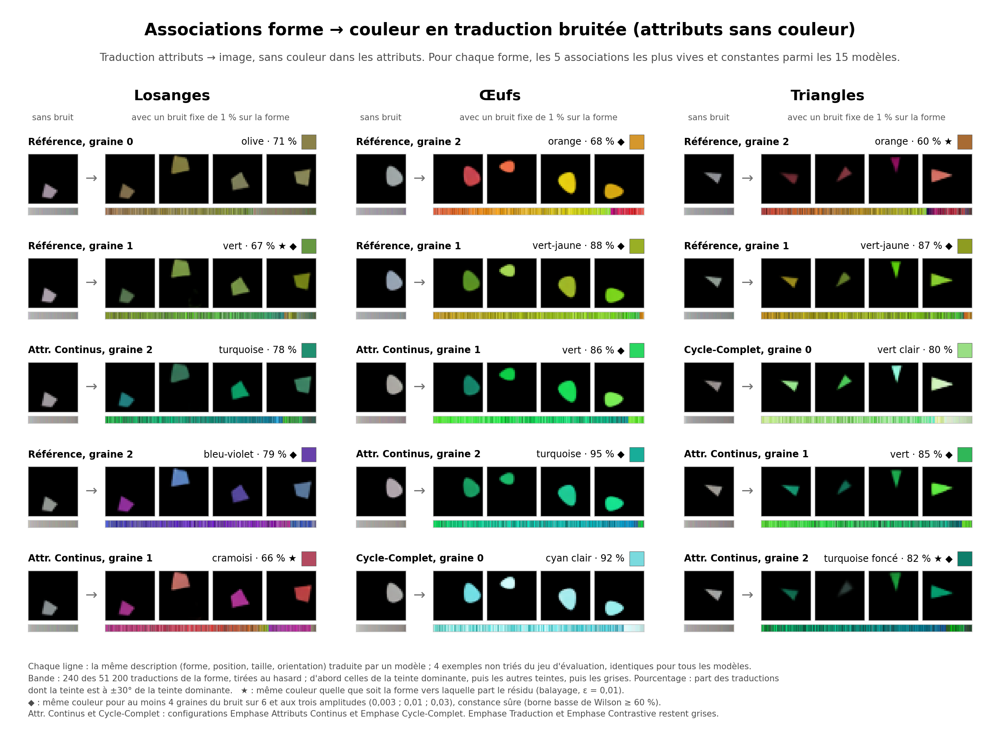
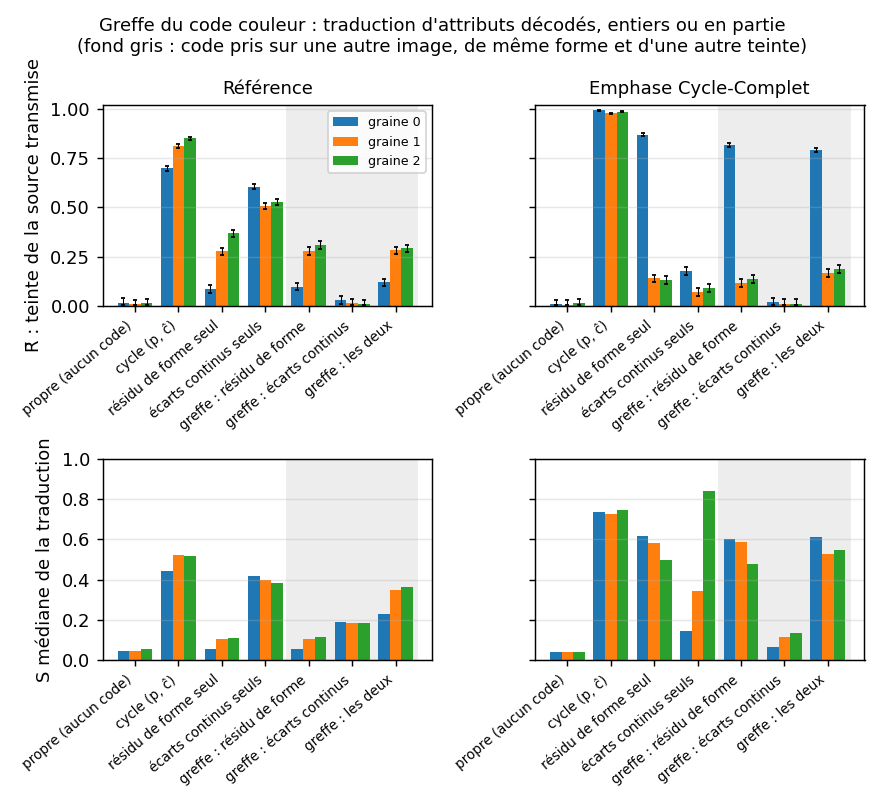
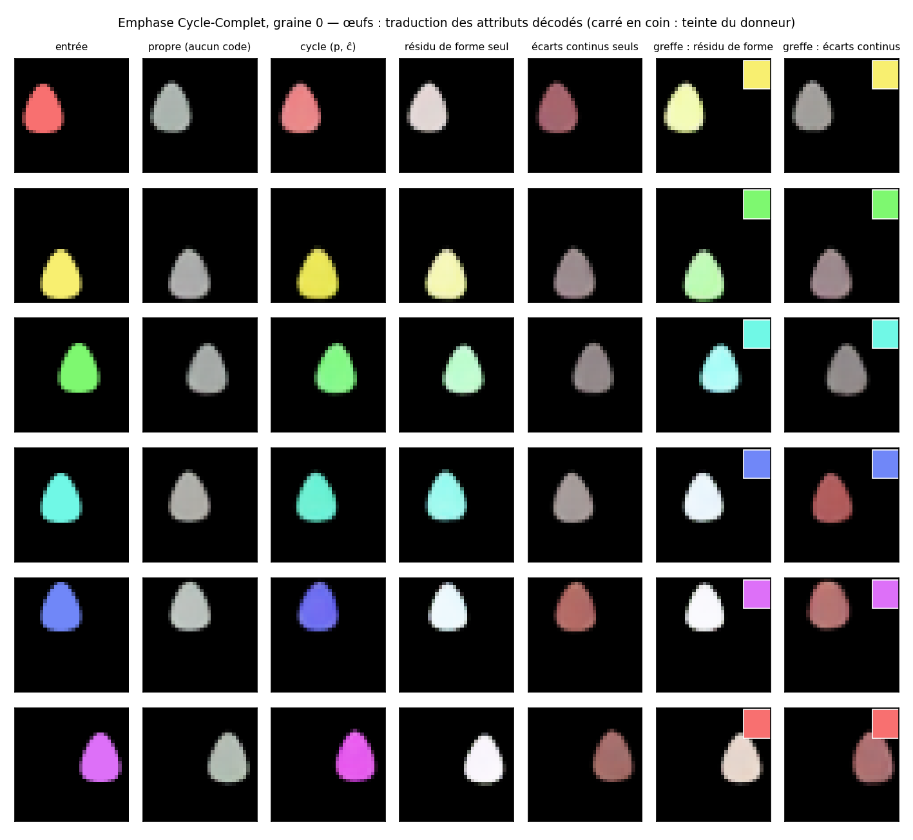
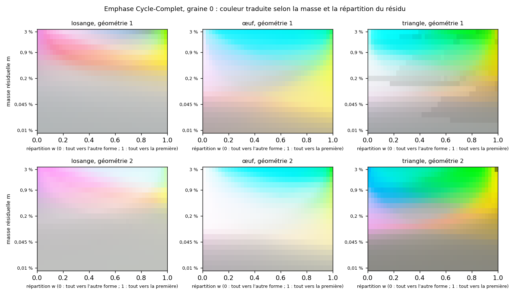
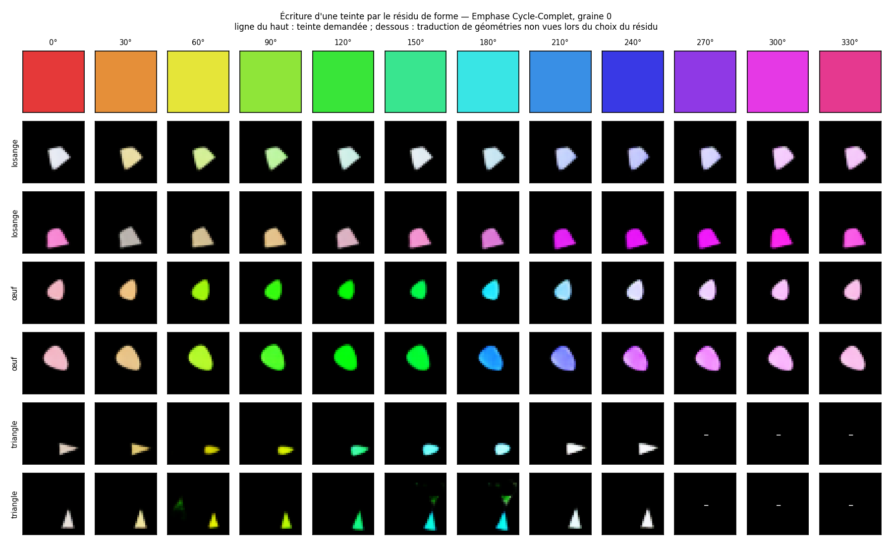

# Un code couleur caché dans les attributs : le mécanisme d'une synesthésie artificielle dans un Global Workspace

*Brouillon d'article — branche `publication`. Figures : `paper/figures/` ; supplément :
[`paper/supplementaire/`](supplementaire/README.md).*

## Résumé

Un Global Workspace (GW) bimodal apprend à relier des images de formes simples et un vecteur
d'attributs (forme, taille, position, orientation). Quand la couleur est absente des attributs, le
modèle doit l'inventer pour traduire des attributs en image ; il produit alors des associations forme →
couleur propres à chaque modèle, analogues à une synesthésie [1]. Nous montrons que ces couleurs ne sont
pas inventées : **le décodeur d'attributs cache la couleur de l'image dans ses sorties**, par deux
canaux. Le premier est une infime masse de probabilité attribuée aux formes absentes (0,01 à 1 %), qui
forme un code indépendant de la géométrie. Le second est fait de petits écarts des attributs continus,
qui ne se lisent qu'avec la géométrie de l'image. **Le GW lit ces codes** : traduire des attributs
exacts donne un gris ; réinjecter les attributs décodés redonne exactement la couleur restituée par le
cycle complet ; greffer le seul résidu de forme d'une image sur la géométrie d'une autre transmet la
teinte du donneur. Dans un modèle, le résidu seul est un code couleur complet : il couvre tout le cercle
des teintes, ne dépend presque pas de la géométrie et permet d'**écrire** une teinte choisie sur des
formes jamais vues (94 % de réussite pour les œufs). La synesthésie artificielle est la lecture de ce
canal à partir d'un petit résidu fixe. Renforcer la cohérence de cycle amplifie le phénomène et déplace
le code vers le résidu de forme, ce qui le rapproche de la stéganographie des modèles à cohérence de
cycle [4].

## 1. Introduction

Dans un GW [2, 3], des encodeurs projettent chaque modalité dans un espace de travail commun et des
décodeurs en reconstruisent chaque modalité. Entraîné sur des paires image-attributs, le modèle sait
**traduire** (attributs → GW → image) et parcourir un **cycle complet** (image → GW → attributs → GW →
image). Si la couleur est retirée des attributs, la traduction doit produire une couleur que rien ne
spécifie, et le cycle complet devrait la perdre. Des travaux antérieurs [1] ont rapporté que la teinte
produite en traduction dépend de la forme au sein d'un modèle et change d'un modèle à l'autre, par
analogie avec la synesthésie humaine.

Nous identifions le mécanisme de ce phénomène :

1. Sans perturbation, la traduction est grise ; une infime masse de probabilité sur les formes absentes
   suffit à la colorer (§ 3.1).
2. Le décodeur d'attributs cache la couleur de l'image dans ses sorties (§ 3.2).
3. Le GW lit ce code, par deux canaux : le résidu de forme, transportable d'une image à l'autre, et les
   écarts des attributs continus, liés à la géométrie (§ 3.3).
4. Le canal de forme se cartographie et s'écrit : une teinte choisie s'obtient en dosant le résidu
   (§ 3.4).
5. Renforcer la cohérence de cycle amplifie le canal caché (§ 3.5).

## 2. Méthodes

**Modèles.** GW de la bibliothèque `shimmer` [2]. Domaine image : latent d'un VAE pré-entraîné (12
dimensions). Domaine attributs : probabilités des 3 formes (losange, œuf, triangle) et 5 attributs
continus (position x, y, taille, cosinus et sinus de l'orientation). Deux réglages, trois graines
chacun, sans couleur dans les attributs :

- **Référence** : poids des pertes par défaut (traduction 1, contrastive 0,1, demi-cycle 1, cycle 1) ;
- **Emphase Cycle-Complet** : cohérence de cycle ×10.

Contrôles : un modèle par réglage entraîné avec la couleur dans les attributs (« Modèle Complet »).

**Données.** Simple Shapes [2] ; évaluation sur 153 600 images de 32 × 32 pixels : 3 formes × 25 teintes
(saturation 0,91 et luminosité 0,71 fixes) × 8 tailles × 16 orientations × 16 positions.

**Mesure de la couleur.** Masque de la forme par seuillage d'Otsu, couleur moyenne de 3 × 3 pixels au
barycentre ; teinte h et saturation S (HLS) ; plan de chrominance a = R − (G + B)/2,
b = √3/2 (G − B). Transmission de la teinte d'une source vers une sortie :
R̄ = |moyenne de exp(i(h_sortie − h_source))| (1 : transmise ; 0 : sans rapport).

**Interventions** (toutes en inférence, modèles figés) :

- *Résidu contrôlé* : vecteur de forme p_t = 1 − m, p_j = m·w, p_k = m·(1 − w) (masse m retirée à la
  forme cible t, répartie entre les deux autres selon w), toutes les autres entrées fixées.
- *Réinjection et greffe* : traduction des attributs que le GW décode d'une image (probabilités de forme
  p, attributs continus ĉ), entiers ou en partie, éventuellement posés sur la géométrie d'une autre
  image de même forme et d'une autre teinte (4 800 images par modèle).
- *Carte et écriture* : grille de 20 masses (0,01 à 3 %) × 41 répartitions sur 24 géométries ; pour chaque
  teinte cible, (m, w) choisi sur la moitié des géométries et testé sur l'autre moitié.

**Statistiques.** Unités explicites (exemple, image, modèle) ; intervalles de confiance à 95 % par
bootstrap ou de Wilson ; tests appariés de Wilcoxon ; correction de Holm.

## 3. Résultats

### 3.1 Sans résidu la traduction est grise ; une infime masse résiduelle la colore

À partir d'attributs exacts, les modèles sans couleur traduisent en formes presque grises : saturation
médiane 0,05 (Référence) et 0,04 (Emphase Cycle-Complet), contre 0,91 en entrée et 0,80 à 0,83 chez les
contrôles (figure S1).

Retirer 0,7 à 0,8 % de masse à la forme cible change tout (figure 2) : la saturation passe à 0,71–0,81
chez Référence graines 1 et 2 et à 0,59–0,85 chez Emphase Cycle-Complet (39 à 48 exemples colorés sur
48 ; Wilcoxon apparié, p < 10⁻⁴ après correction de Holm), avec une relation dose-réponse croissante
(ρ de Spearman médian par exemple ≥ 0,93). Chez Référence, 0,07 à 0,15 % suffit déjà. La même
perturbation appliquée aux attributs continus déplace la couleur 84 à 166 fois moins (sauf Référence
graine 0). La saturation des contrôles ne bouge pas. La forme reste reconnue (95 à 100 %, sauf Emphase
Cycle-Complet graine 1 : 72 %). Une instance, Référence graine 0, ne répond que pour les losanges.
Statistiques : supplément S1.

**Figure 1 — Une synesthésie qui n'apparaît qu'avec un résidu.** Chaque ligne : la même description
(forme, position, taille, orientation) traduite par un modèle, avec des attributs exacts (à gauche,
toujours gris) puis avec un résidu fixe de 1 % (4 exemples non triés) ; bande : 240 des 51 200
traductions de la forme ; pourcentage : part des traductions à ±30° de la teinte dominante.
★ : même couleur quelle que soit la forme qui reçoit le résidu ; ◆ : même couleur pour au moins 4
directions de résidu sur 6 et trois amplitudes. Pour chaque forme, les associations les plus nettes parmi
les 6 modèles (au plus 5 ; seules celles de constance ≥ 60 % sont retenues).

**Figure 2 — Effet dose-réponse de la masse résiduelle.** Gauche : saturation médiane des traductions
selon l'amplitude ε de la perturbation du vecteur de forme (masse retirée : 0,71 ε à 0,82 ε ; premier
point : sans perturbation) ; une courbe par instance ; tirets gris : contrôles ; la courbe basse de
Référence est la graine 0. Centre : même perturbation sur les attributs continus (témoin de spécificité).
Droite : forme reconnue après ré-encodage de l'image traduite (traits pleins : directions qui restent dans
le simplexe ; pointillés : hors du simplexe).

### 3.2 Le décodeur d'attributs cache la couleur de l'image

Nous avons fait passer 19 200 images par image → VAE → GW → décodeur d'attributs et prédit la couleur
d'entrée à partir des seules sorties du décodeur (régressions ridge, k plus proches voisins et petit
perceptron ; R² en validation croisée ; couleurs mélangées : R² ≤ 0).

| R² de la chrominance d'entrée | résidu de forme | écarts continus + géométrie | tout | latent du GW | transmission en cycle complet R̄ |
|---|---|---|---|---|---|
| Référence (3 graines) | 0,36 (0,24–0,43) | 0,60 | 0,83 (0,75–0,89) | 0,95 | 0,79 |
| Emphase Cycle-Complet (3 graines) | 0,65 (0,42–0,96) | 0,55 | 0,96 (0,94–0,98) | 0,99 | 0,99 |
| Contrôles | ≤ 0,02 | ≤ 0,13 | ≤ 0,15 | 1,00 | – |

La couleur se relit dans des sorties qui n'en contiennent pas ; les contrôles, qui la reçoivent par un
attribut dédié, n'en cachent pas. Le latent du GW contient la couleur ; c'est le décodeur d'attributs
qui la laisse fuir. Ce qui se relit prédit ce que le cycle complet restitue (ρ de Spearman 0,99 sur
15 modèles, dont ceux de trois réglages exploratoires ; supplément). Les résidus en jeu sont ceux du
§ 3.1 : sur de vraies images, la masse résiduelle produite par le décodeur a pour médiane 0 à 0,02 % chez
Référence (15 à 27 % des images au-delà de 0,07 %) et 0,4 à 1 % chez Emphase Cycle-Complet.

**Figure 3 — La couleur de l'image se relit dans les attributs décodés.** R² de la chrominance d'entrée
par modèle et groupe de variables (bleu : résidu de forme ; rouge : écarts des attributs continus ;
vert : écarts + géométrie ; jaune : tout) ; trait noir : couleur lue dans le latent du GW ; étoile :
contrôles. Droite : R² du résidu (bleu) et de « tout » (jaune) contre la transmission de la teinte en
cycle complet, une marque par instance.

### 3.3 Le GW lit ce code, par deux canaux

Pour chaque image, nous traduisons des vecteurs d'attributs construits à partir de ce que le GW en décode
et mesurons la transmission R̄ de la teinte de l'image source (figure 4 ; 4 800 images par modèle ; IC à
95 % de largeur ≤ 0,04) :

| R̄ (teinte de la source) | attributs exacts | décodés entiers (p, ĉ) | résidu de forme seul (p, c) | écarts continus seuls (t, ĉ) | greffe : résidu d'une autre image | greffe : écarts d'une autre image |
|---|---|---|---|---|---|---|
| Référence, graines 0 / 1 / 2 | 0,01–0,02 | 0,70 / 0,81 / 0,85 | 0,09 / 0,28 / 0,37 | 0,61 / 0,51 / 0,53 | 0,10 / 0,28 / 0,31 | 0,01–0,03 |
| Emphase Cycle-Complet, graines 0 / 1 / 2 | 0,00–0,01 | 0,99 / 0,98 / 0,99 | 0,87 / 0,14 / 0,13 | 0,18 / 0,07 / 0,09 | 0,82 / 0,12 / 0,13 | 0,01–0,02 |

Pour les greffes, la source est l'image donneuse ; la teinte du receveur n'est pas transmise (R̄ ≤ 0,04).

- **Le GW lit le code.** Des attributs exacts donnent un gris ; les attributs décodés redonnent la
  couleur, exactement au niveau du cycle complet de l'évaluation standard (ρ de Spearman 1,00 sur les 6
  instances, écart médian 0,002).
- **Le résidu de forme est un code transportable.** Greffé sur la géométrie d'une autre image, il
  transmet la teinte du donneur aussi bien que sur sa propre image (écart ≤ 0,06). Chez Emphase
  Cycle-Complet graine 0, il porte à lui seul presque toute la couleur (R̄ = 0,87 ; greffé : 0,82).
- **Les écarts des attributs continus sont un code lié à la géométrie.** Sur leur propre image, ils
  transmettent la couleur, surtout chez Référence (0,51 à 0,61) ; greffés sur une autre géométrie, plus
  rien (≤ 0,03).
- **Les deux canaux se combinent.** Chez Emphase Cycle-Complet graines 1 et 2, chaque canal seul
  transmet peu (0,07 à 0,14), les deux ensemble presque tout (0,98–0,99) : le code est conjoint.
- **Les canaux se partagent le cercle des teintes** (figure S10). Chez Référence, de façon semblable
  pour les trois graines, le résidu de forme transmet une bande jaune-orangé (environ 40 à 110°), les
  écarts continus les verts (environ 120 à 170°) et les bleu-violet (environ 240 à 300°) ; le cycle
  complet restitue l'union de ces bandes et perd les rouges et les cyans.

**Figure 4 — Réinjection et greffe du code couleur.** Haut : transmission R̄ de la teinte de l'image source
(l'image elle-même ; le donneur pour les greffes, sur fond gris), par condition et par instance, IC à
95 % ; bas : saturation médiane des traductions. Attributs exacts : gris ; attributs décodés entiers : la
couleur revient ; le résidu de forme d'une autre image transmet sa teinte ; les écarts continus d'une
autre image, non.

**Figure 4b — Exemples (Emphase Cycle-Complet graine 0, œufs).** Colonnes : image d'entrée ; traduction
des attributs exacts (gris) ; des attributs décodés entiers (la couleur revient) ; du seul résidu de
forme ; des seuls écarts continus ; du résidu de forme d'une autre image (carré en coin : teinte de cette
image) ; des écarts continus d'une autre image. Le résidu greffé transmet la teinte du donneur (jaune,
vert, cyan), parfois pâlie ; les écarts continus greffés ne transmettent rien. Référence : figure S11.

### 3.4 Carte et écriture du canal de forme

Nous avons traduit, pour chaque forme et 8 géométries, une grille de 20 masses résiduelles (0,01 à 3 %)
× 41 répartitions entre les deux formes absentes (figure 6).

Chez **Emphase Cycle-Complet graine 0**, le résidu seul est un code couleur complet :

- il colore la traduction dès 0,03 % de masse (œufs ; 0,08 % pour les triangles, 0,27 % pour les
  losanges) ; à 1 %, saturation médiane 0,73 à 0,92, forme reconnue à 100 % ;
- il atteint tous les secteurs de 30° du cercle des teintes pour les losanges et les œufs (9 sur 12 pour
  les triangles) ;
- il ne dépend presque pas de la géométrie : à résidu égal, l'écart-type circulaire de la teinte entre
  géométries est de 6° (œufs) et 4° (triangles), 32° pour les losanges ;
- il permet d'**écrire** une teinte : en choisissant (m, w) sur 4 géométries, on obtient la teinte voulue
  (±30°, forme colorée et reconnue) sur 4 autres géométries dans 94 % des cas pour les œufs (12 cibles
  sur 12 atteignables), 72 % pour les triangles (9 sur 12) et 48 % pour les losanges (figure 7). Les verts
  et les cyans sont saturés ; les rouges, les bleus et les magentas restent pâles.

Dans les autres instances, le canal de forme est plus pauvre : 0 à 4 secteurs atteints, une teinte qui
dépend davantage de la géométrie (17 à 67°) et 0 à 5 teintes cibles atteignables par forme (figures S12
à S14). La richesse du code de forme est donc propre à chaque instance, comme les associations
synesthésiques qu'il produit.

**Figure 5 — La couleur suit la répartition du résidu (Emphase Cycle-Complet).** Déplacement moyen
(Δa, Δb) de la couleur traduite pour 36 directions de perturbation du vecteur de forme (ε = 0,01) ; un
panneau par forme, une courbe par instance (gris : contrôle) ; trait épais : directions qui restent dans
le simplexe, de « tout vers une forme absente » à « tout vers l'autre ». Chaque instance a sa propre
direction (arbitraire) et la couleur parcourt un grand arc quand la répartition change. Référence :
figure S5.

**Figure 6 — Carte du code de forme (Emphase Cycle-Complet graine 0).** Couleur réellement produite en
traduction selon la masse résiduelle m (ordonnée, échelle logarithmique) et sa répartition w entre les
deux formes absentes (abscisse), pour deux géométries de chaque forme. Sous 0,03 % la forme est grise ;
au-delà, la teinte dépend de façon régulière de (m, w), et la carte est presque la même d'une géométrie à
l'autre pour les œufs et les triangles.

**Figure 7 — Écrire une teinte avec le résidu de forme (Emphase Cycle-Complet graine 0).** Ligne du
haut : teinte demandée ; dessous : traduction, sur des géométries non utilisées pour choisir le résidu,
avec la masse et la répartition choisies pour cette teinte (moins de 3 % de masse ; « – » : teinte non
atteignable pour cette forme).

### 3.5 La cohérence de cycle amplifie le canal caché

| | Référence | Emphase Cycle-Complet |
|---|---|---|
| Masse résiduelle produite sur de vraies images (médiane) | 0–0,02 % | 0,4–1 % |
| Transmission de la teinte en cycle complet | 0,70–0,85 | 0,98–0,99 |
| R² de la couleur d'entrée, résidu de forme seul (régression) | 0,24–0,43 | 0,42–0,96 |
| Résidu de forme seul, réinjecté (R̄) | 0,09–0,37 | 0,13–0,87 |
| Écarts continus seuls, réinjectés (R̄) | 0,51–0,61 | 0,07–0,18 |
| Dépendance de la teinte à la répartition du résidu (écart médian entre extrêmes) | 18–28° (2 instances sur 3) | 65–156° |

Avec une cohérence de cycle dix fois plus forte, la couleur traverse le cycle complet presque intacte,
le décodeur produit des résidus des dizaines de fois plus grands, et le code se déplace des attributs
continus vers le résidu de forme, au point de former, dans une instance, un code couleur complet et
indépendant de la géométrie. Chez Emphase Cycle-Complet, même le contrôle, qui reçoit pourtant la couleur,
reste sensible au résidu de forme (supplément S1).

## 4. Discussion

**Une stéganographie induite par la cohérence de cycle.** Pour reconstruire l'image après un passage par
les attributs, un modèle privé d'attribut de couleur a intérêt à cacher la couleur dans ce qu'il décode.
Les modèles de type CycleGAN cachent ainsi de l'information dans des signaux de faible amplitude [4, 5].
Nous retrouvons ce phénomène dans un GW, sur une sortie symbolique (des probabilités de classes) et sur
des attributs continus, et nous montrons qu'il est lu : réinjecté, le code restitue la couleur ; greffé,
il la transporte. La synesthésie artificielle en découle : traduire avec un petit résidu fixe revient à
lire le canal de forme de ce code, d'où une couleur propre à chaque forme et à chaque modèle.

**Deux canaux de nature différente.** Le résidu de forme est un code indépendant de la géométrie, qu'on
peut cartographier, transporter et écrire. Les écarts des attributs continus forment un code lié à la
géométrie : ils ne prennent sens qu'avec la position, la taille et l'orientation de l'image. Chez
Référence, les deux canaux se partagent le cercle des teintes de façon reproductible d'une graine à
l'autre ; chez Emphase Cycle-Complet, ils se combinent en un code conjoint.

**Conséquences.** (i) Un « vide sémantique » n'est pas vide : la couleur passe par les canaux censés
l'exclure. (ii) Une teinte de gris n'est pas une couleur : les mesures de synesthésie doivent contrôler
la saturation. (iii) Une association « ce modèle voit les X en Y » ne vaut que pour une direction de
résidu (figure S8).

**Limites.** Trois instances par réglage ; deux réglages seulement pour la cohérence de cycle ; un seul
jeu de données, à saturation et luminosité fixes ; un seul code de forme vraiment complet sur six
instances.

## 5. Suite

- **Amplifier par l'entraînement** : plusieurs poids de cohérence de cycle (×3, ×30) et plus de graines,
  pour établir une relation dose-réponse et la fréquence des codes de forme complets ; un entraînement qui
  durcit les probabilités de forme en one-hot devrait supprimer le canal de forme et la synesthésie, mais
  pas forcément la transmission par les attributs continus.
- **Capacité des canaux** : bits de couleur transmis par chaque canal (information mutuelle entre teinte
  d'entrée et teinte restituée).

## Références

1. Emanuelli, A. (2025). *Définition et émergence d'une synesthésie artificielle dans un modèle
   d'apprentissage profond inspiré de la théorie du Global Workspace* [Mémoire de M2].
2. Devillers, B., Maytié, L., VanRullen, R. (2024). *Semi-supervised multimodal representation learning
   through a global workspace.*
3. VanRullen, R., Kanai, R. (2021). *Deep learning and the Global Workspace Theory.*
4. Chu, C., Zhmoginov, A., Sandler, M. (2017). *CycleGAN, a master of steganography.*
5. Zhu, J.-Y., Park, T., Isola, P., Efros, A. A. (2017). *Unpaired image-to-image translation using
   cycle-consistent adversarial networks.*
