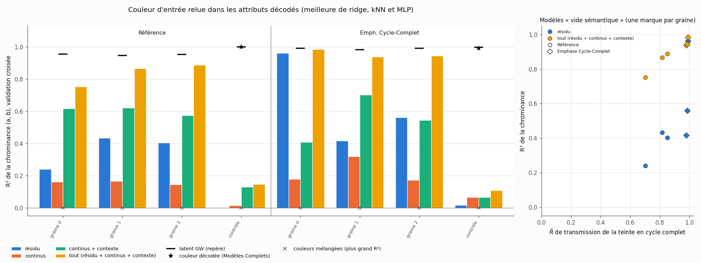

# Un code couleur caché dans les probabilités de forme : le mécanisme d'une synesthésie artificielle dans un Global Workspace

*Brouillon d'article — branche `publication`. Figures : `paper/figures/` ; supplément :
[`paper/supplementaire/`](supplementaire/README.md). Les passages entre crochets attendent des calculs
en cours.*

## Résumé

Un Global Workspace (GW) bimodal apprend à relier des images de formes simples et un vecteur
d'attributs (forme, taille, position, orientation). Quand la couleur est absente des attributs, le
modèle doit l'inventer pour traduire des attributs en image ; il produit alors des associations forme →
couleur propres à chaque modèle, analogues à une synesthésie [1]. Nous montrons que ces couleurs ne
sont pas inventées. **Le décodeur d'attributs cache la couleur de l'image dans ses sorties**, d'abord
dans une infime masse de probabilité attribuée aux formes absentes (0,01 à 1 %) : la couleur d'entrée
s'y relit (R² jusqu'à 0,96 pour ce seul résidu), alors que ces sorties ne sont pas censées la contenir.
**Le GW lit ce code** : traduire des attributs exacts donne un gris, mais réinjecter le seul résidu de
forme d'une image restitue sa teinte, et le greffer sur les attributs d'une autre image transmet la
teinte du donneur. Le code est une fonction régulière de la répartition et de la masse du résidu,
[indépendante de la géométrie,] et permet d'**écrire** une teinte choisie à l'avance avec moins de 1 %
de masse résiduelle. La synesthésie apparaît quand un petit résidu fixe est ajouté à l'entrée : le
modèle le lit comme un code couleur. Renforcer la cohérence de cycle amplifie ce canal caché, ce qui le
rapproche de la stéganographie décrite dans les modèles à cohérence de cycle [4].

## 1. Introduction

Dans un GW [2, 3], des encodeurs projettent chaque modalité dans un espace de travail commun et des
décodeurs en reconstruisent chaque modalité. Entraîné sur des paires image-attributs, le modèle sait
**traduire** (attributs → GW → image) et parcourir un **cycle complet** (image → GW → attributs → GW →
image). Si la couleur est retirée des attributs, la traduction doit produire une couleur que rien ne
spécifie, et le cycle complet devrait la perdre. Des travaux antérieurs [1] ont rapporté que la teinte
produite en traduction dépend de la forme au sein d'un modèle et change d'un modèle à l'autre, par
analogie avec la synesthésie humaine.

Nous identifions le mécanisme de ce phénomène :

1. Sans perturbation, la traduction est grise ; une infime masse de probabilité sur les formes absentes
   suffit à la colorer (§ 3.1).
2. Le décodeur d'attributs cache la couleur de l'image dans ce résidu, et dans de petits écarts des
   attributs continus (§ 3.2).
3. Le GW lit ce code : réinjecté, il restitue la couleur ; greffé, il transmet la couleur du donneur
   (§ 3.3).
4. Le code se cartographie et s'écrit : une teinte choisie s'obtient en dosant le résidu (§ 3.4).
5. Renforcer la cohérence de cycle amplifie le canal caché (§ 3.5).

## 2. Méthodes

**Modèles.** GW de la bibliothèque `shimmer` [2]. Domaine image : latent d'un VAE pré-entraîné (12
dimensions). Domaine attributs : probabilités des 3 formes (losange, œuf, triangle) et 5 attributs
continus (position x, y, taille, cosinus et sinus de l'orientation). Deux réglages, trois graines
chacun, sans couleur dans les attributs :

- **Référence** : poids des pertes par défaut (traduction 1, contrastive 0,1, demi-cycle 1, cycle 1) ;
- **Emphase Cycle-Complet** : cohérence de cycle ×10.

Contrôles : un modèle par réglage entraîné avec la couleur dans les attributs (« Modèle Complet »).

**Données.** Simple Shapes [2] ; évaluation sur 153 600 images de 32 × 32 pixels : 3 formes × 25 teintes
(saturation 0,91 et luminosité 0,71 fixes) × 8 tailles × 16 orientations × 16 positions.

**Mesure de la couleur.** Masque de la forme par seuillage d'Otsu, couleur moyenne de 3 × 3 pixels au
barycentre ; teinte h et saturation S (HLS) ; plan de chrominance a = R − (G + B)/2,
b = √3/2 (G − B). Transmission de la teinte d'une source vers une sortie :
R̄ = |moyenne de exp(i(h_sortie − h_source))| (1 : transmise ; 0 : sans rapport).

**Interventions** (toutes en inférence, modèles figés) :

- *Résidu contrôlé* : vecteur de forme p_t = 1 − m, p_j = m·w, p_k = m·(1 − w) (masse m retirée à la
  forme cible t, répartie entre les deux autres selon w), toutes les autres entrées fixées.
- *Réinjection et greffe* : traduction des attributs que le GW décode d'une image, entiers ou en partie,
  éventuellement posés sur la géométrie d'une autre image.
- *Écriture* : choix de (m, w) pour obtenir une teinte cible, sur des géométries distinctes de celles
  qui servent au test.

**Statistiques.** Unités explicites (exemple, image, modèle) ; intervalles de confiance à 95 % par
bootstrap ou de Wilson ; tests appariés de Wilcoxon ; correction de Holm.

## 3. Résultats

### 3.1 Sans résidu la traduction est grise ; une infime masse résiduelle la colore

À partir d'attributs exacts, les modèles sans couleur traduisent en formes presque grises : saturation
médiane 0,05 (Référence) et 0,04 (Emphase Cycle-Complet), contre 0,91 en entrée et 0,80 à 0,83 chez les
contrôles (figure S1).

Retirer 0,7 à 0,8 % de masse à la forme cible change tout (figure 2) : la saturation passe à 0,71–0,81
chez Référence graines 1 et 2 et à 0,59–0,85 chez Emphase Cycle-Complet (39 à 48 exemples colorés sur
48 ; Wilcoxon apparié, p < 10⁻⁴ après correction de Holm), avec une relation dose-réponse croissante
(ρ de Spearman médian par exemple ≥ 0,93). Chez Référence, 0,07 à 0,15 % suffit déjà. La même
perturbation appliquée aux attributs continus déplace la couleur 84 à 166 fois moins (sauf Référence
graine 0). La saturation des
contrôles ne bouge pas. La forme reste reconnue (95 à 100 %, sauf Emphase Cycle-Complet graine 1 :
72 %). Une instance, Référence graine 0, ne répond que pour les losanges. Statistiques : supplément S1.

**Figure 1 — Une synesthésie qui n'apparaît qu'avec un résidu.** Chaque ligne : la même description
(forme, position, taille, orientation) traduite par un modèle, avec des attributs exacts (à gauche,
toujours gris) puis avec un résidu fixe de 1 % (4 exemples non triés) ; bande : 240 des 51 200
traductions de la forme ; pourcentage : part des traductions à ±30° de la teinte dominante.
★ : même couleur quelle que soit la forme qui reçoit le résidu ; ◆ : même couleur pour au moins 4
directions de résidu sur 6 et trois amplitudes. Pour chaque forme, les associations les plus nettes parmi
les 6 modèles (au plus 5 ; seules celles de constance ≥ 60 % sont retenues).

**Figure 2 — Effet dose-réponse de la masse résiduelle.** Gauche : saturation médiane des traductions
selon l'amplitude de la perturbation du vecteur de forme (premier point : sans perturbation) ; tirets
gris : contrôles. Centre : même perturbation sur les attributs continus (témoin de spécificité). Droite :
forme reconnue (traits pleins : directions qui restent dans le simplexe ; pointillés : hors du simplexe).
Une courbe par instance ; la courbe basse de Référence est la graine 0.

### 3.2 Le décodeur d'attributs cache la couleur de l'image

Nous avons fait passer 19 200 images par image → VAE → GW → décodeur d'attributs et prédit la couleur
d'entrée à partir des seules sorties du décodeur (régressions ridge, k plus proches voisins et petit
perceptron ; R² en validation croisée ; couleurs mélangées : R² ≤ 0).

| R² de la chrominance d'entrée | résidu de forme | écarts continus + géométrie | tout | latent du GW | transmission en cycle complet R̄ |
|---|---|---|---|---|---|
| Référence (3 graines) | 0,36 (0,24–0,43) | 0,60 | 0,83 (0,75–0,89) | 0,95 | 0,79 |
| Emphase Cycle-Complet (3 graines) | 0,65 (0,42–0,96) | 0,55 | 0,96 (0,94–0,98) | 0,99 | 0,99 |
| Contrôles | ≤ 0,02 | ≤ 0,13 | ≤ 0,15 | 1,00 | – |

La couleur se relit dans des sorties qui n'en contiennent pas ; les contrôles, qui la reçoivent par un
attribut dédié, n'en cachent pas. Le latent du GW contient la couleur ; c'est le décodeur d'attributs
qui la laisse fuir. Ce qui se relit **prédit ce que le cycle complet restitue** (ρ de Spearman 0,99 sur
15 modèles, dont ceux de trois réglages exploratoires ; supplément). Ces résidus sont du même ordre que ceux du § 3.1 : sur de vraies
images, la masse résiduelle produite par le décodeur a pour médiane 0 à 0,02 % chez Référence (15 à 27 % des
images au-delà de 0,07 %) et 0,4 à 1 % chez Emphase Cycle-Complet.

**Figure 3 — La couleur de l'image se relit dans les attributs décodés.** R² de la chrominance d'entrée
par modèle et groupe de variables (bleu : résidu de forme ; rouge : écarts des attributs continus ;
vert : écarts + géométrie ; jaune : tout) ; trait noir : couleur lue dans le latent du GW ; étoile :
contrôles. Droite : R² du résidu (bleu) et de « tout » (jaune) contre la transmission de la teinte en cycle
complet, une marque par instance.

### 3.3 Le GW lit ce code : réinjection et greffe

*[Résultats en cours de calcul (`experiments/colour_code_transplant.py`). Essai sur Emphase
Cycle-Complet graine 0, 2 400 images : attributs exacts R̄ = 0,01 (gris) ; attributs décodés entiers
0,99 (le cycle complet) ; résidu de forme seul 0,86 ; écarts continus seuls 0,17 ; résidu de forme
d'une autre image greffé : teinte du donneur R̄ = 0,81, du receveur 0,02 ; écarts continus greffés 0,02.]*

### 3.4 Carte et écriture du code

*[Calcul à lancer après la greffe (`experiments/colour_code_map.py`) : teinte produite selon la masse m
et la répartition w du résidu ; invariance à la géométrie ; écriture de 12 teintes cibles sur des
géométries non vues.]*

**Figure 5 — La couleur suit la répartition du résidu (Emphase Cycle-Complet).** Déplacement moyen
(Δa, Δb) de la couleur traduite pour 36 directions de perturbation du vecteur de forme ; un panneau par
forme, une courbe par instance (gris : contrôle) ; trait épais : directions qui restent dans le simplexe,
de « tout vers une forme non cible » à « tout vers l'autre ». Chaque instance a sa propre direction
(arbitraire) et la couleur parcourt un grand arc quand la répartition change. Référence : figure S5.

### 3.5 La cohérence de cycle amplifie le canal caché

| | Référence | Emphase Cycle-Complet |
|---|---|---|
| Masse résiduelle produite sur de vraies images (médiane) | 0–0,02 % | 0,4–1 % |
| R² de la couleur d'entrée, résidu de forme seul | 0,36 | 0,65 (jusqu'à 0,96) |
| Transmission de la teinte en cycle complet | 0,79 | 0,99 |
| Dépendance de la teinte à la répartition du résidu (écart médian entre extrêmes) | 18–28° (2 instances sur 3) | 65–156° |
| Réinjection du résidu de forme seul (R̄) | [en cours] | [en cours] (essai : 0,86) |

Avec une cohérence de cycle dix fois plus forte, le décodeur produit des résidus des dizaines de fois
plus grands, y place davantage de couleur, et le GW la restitue presque parfaitement. Chez Emphase
Cycle-Complet, même le contrôle, qui reçoit pourtant la couleur, reste sensible au résidu de forme
(supplément S1).

## 4. Discussion

**Une stéganographie induite par la cohérence de cycle.** Pour reconstruire l'image après un passage par
les attributs, un modèle privé d'attribut de couleur a intérêt à cacher la couleur dans ce qu'il décode.
Les modèles de type CycleGAN cachent ainsi de l'information dans des signaux de faible amplitude [4, 5].
Nous retrouvons ce phénomène dans un GW, sur une sortie symbolique (des probabilités de classes), et il
explique une synesthésie artificielle : traduire avec un résidu revient à lire le code couleur que le
modèle s'est donné.

**Conséquences.** (i) Un « vide sémantique » n'est pas vide : la couleur passe par les canaux censés
l'exclure. (ii) Une teinte de gris n'est pas une couleur : les mesures de synesthésie doivent contrôler
la saturation. (iii) Une association « ce modèle voit les X en Y » ne vaut que pour une direction de
résidu (supplément, figure S8).

**Limites.** Trois instances par réglage ; deux réglages seulement pour la cohérence de cycle ; un seul
jeu de données, à saturation et luminosité fixes.

## 5. Suite

- **Amplifier par l'entraînement** : plusieurs poids de cohérence de cycle (×3, ×30) pour établir une
  relation dose-réponse ; un entraînement qui durcit les probabilités de forme en one-hot devrait
  supprimer à la fois la transmission en cycle complet et la synesthésie.
- **Capacité du canal** : bits de couleur transmis par le résidu (information mutuelle entre teinte
  d'entrée et teinte restituée).

## Références

1. Emanuelli, A. (2025). *Définition et émergence d'une synesthésie artificielle dans un modèle
   d'apprentissage profond inspiré de la théorie du Global Workspace* [Mémoire de M2].
2. Devillers, B., Maytié, L., VanRullen, R. (2024). *Semi-supervised multimodal representation learning
   through a global workspace.*
3. VanRullen, R., Kanai, R. (2021). *Deep learning and the Global Workspace Theory.*
4. Chu, C., Zhmoginov, A., Sandler, M. (2017). *CycleGAN, a master of steganography.*
5. Zhu, J.-Y., Park, T., Isola, P., Efros, A. A. (2017). *Unpaired image-to-image translation using
   cycle-consistent adversarial networks.*
