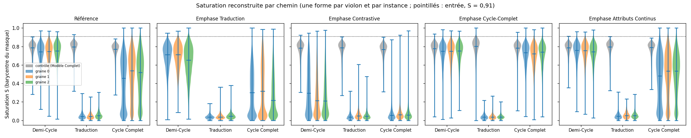
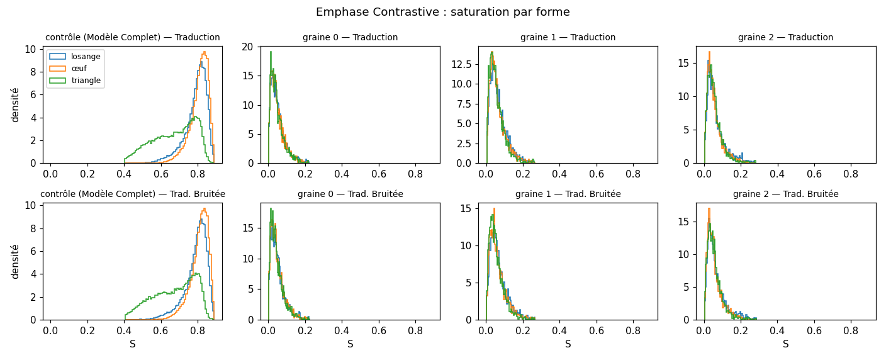
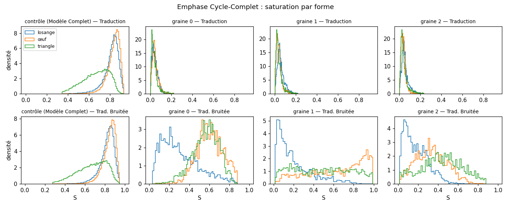
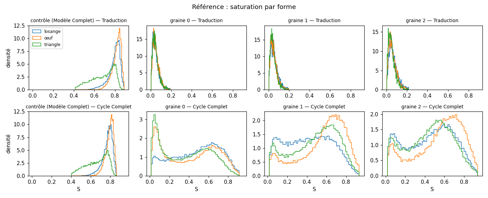
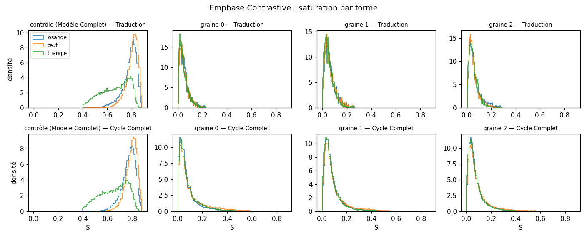
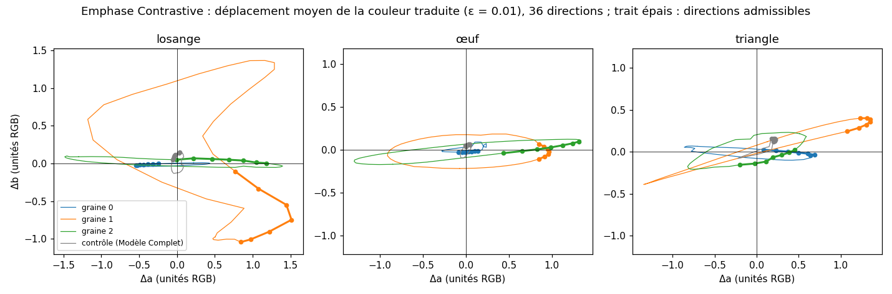
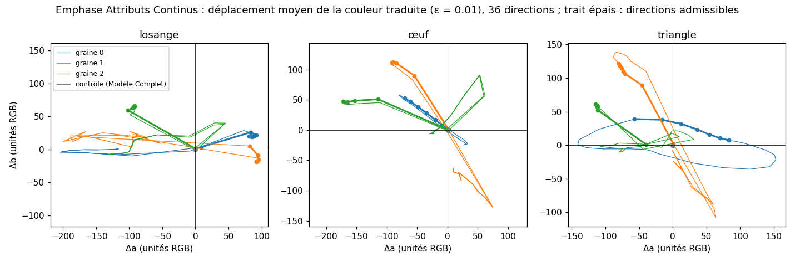
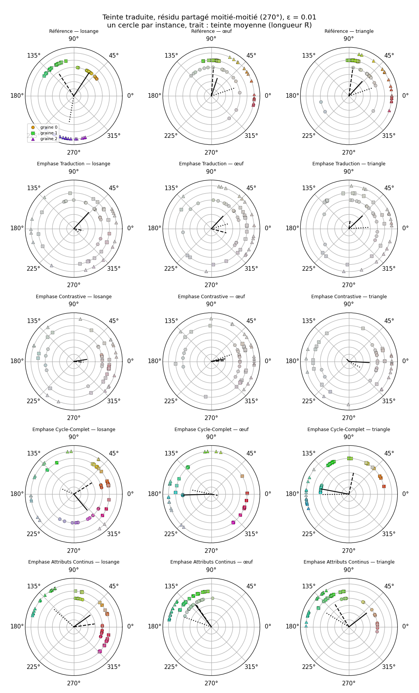

# Supplément

Compléments de l'article [`paper/article.md`](../article.md) : contrôles de mesure, distributions
détaillées, figures par configuration, robustesse et statistiques complètes.

- [S1 — Statistiques de l'intervention sur le résidu de forme](S1_statistiques_intervention.md)
  (dose-réponse, spécificité, résidus produits sur de vraies images, dépendance à la direction).
- [S2 — Robustesse](S2_robustesse.md) (autre extraction de la couleur, directions et amplitudes du
  résidu, comparaisons multiples, sous-ensembles d'images de la régression).

## Contrôle de mesure

Sur 6 000 images, sans GW, l'extraction redonne S = 0,907 en entrée (0,884 pour les triangles, 0,876
pour la plus petite taille). Le seul passage par le VAE ramène S à 0,80 (losange 0,81, œuf 0,83,
triangle 0,72 ; taille 7 : 0,70, taille 14 : 0,83). Un écart de saturation entre formes ou tailles peut
donc venir de la mesure : chaque comparaison est rapportée aux contrôles.

## Saturation selon le chemin

| Médiane de S (entrée : 0,91) | Reconstruction* | Traduction | Traduction avec résidu de 1 % | Cycle complet* |
|---|---|---|---|---|
| Contrôles (4) | 0,79–0,80 | 0,80–0,83 | 0,80–0,84 | 0,78–0,80 |
| Référence | 0,76 | 0,05 | 0,46 | 0,49 |
| Emphase Traduction | 0,71 | 0,04 | 0,04 | 0,28 |
| Emphase Contrastive | 0,21 | 0,05 | 0,05 | 0,06 |
| Emphase Cycle-Complet | 0,77 | 0,04 | 0,44 | 0,72 |
| Emphase Attributs Continus | 0,77 | 0,05 | 0,62 | 0,51 |

\* Valeurs approchées (RGB arrondis à l'entier ; erreur médiane vérifiée < 0,005).

**Figure S1 — Saturation des traductions, sans et avec résidu (valeurs exactes).** Un panneau par
configuration ; un violon par instance (gris : contrôle ; bleu, orange, vert : graines 0, 1, 2) ; trait
horizontal : médiane ; pointillés : saturation d'entrée. Sans résidu, toutes les instances sans couleur
sont grises ; avec le résidu, Référence (graines 1, 2), Emphase Cycle-Complet et Emphase Attributs Continus
(graines 1, 2) produisent des couleurs saturées.

**Figure S2 — Saturation en reconstruction, traduction et cycle complet (valeurs approchées).** Même
codage. En cycle complet, la distribution est souvent bimodale (une partie des images ressort saturée,
l'autre grise) ; Emphase Cycle-Complet garde des couleurs saturées pour presque toutes les images,
Emphase Contrastive les perd presque toutes.

<b>Figure S3 — Saturation par forme, traduction sans et avec résidu (5 configurations)</b>

**Figure S3 — Distribution de S par forme et par instance**, traduction (haut) et traduction avec résidu
(bas) ; a à e : Référence, Emphase Traduction, Emphase Contrastive, Emphase Cycle-Complet, Emphase
Attributs Continus. Avec le résidu, les formes se séparent différemment selon l'instance (par exemple,
Emphase Cycle-Complet graine 0 : losanges vers 0,2, œufs et triangles vers 0,6). Chez les contrôles, les
triangles sont moins saturés que les autres formes avec ou sans résidu : effet de mesure.

<b>Figure S4 — Saturation par forme, traduction et cycle complet (5 configurations)</b>

**Figure S4 — Distribution de S par forme en traduction (haut) et en cycle complet (bas, valeurs
approchées).** Emphase Cycle-Complet restitue des couleurs saturées pour les trois formes et les trois
instances ; Référence, Emphase Traduction et Emphase Attributs Continus mêlent images saturées et grises ;
Emphase Contrastive les ramène presque toutes au gris.

## Direction du résidu et couleur

<b>Figure S5 — Déplacement de la couleur dans le plan de chrominance (4 autres configurations)</b>

**Figure S5 — Comme la figure 5, pour Référence (a), Emphase Traduction (b), Emphase Contrastive (c) et
Emphase Attributs Continus (d).** Attention aux échelles : ±150 à ±200 unités RGB pour a et d, ±10 pour b,
±1,5 pour c. Chez Référence et Emphase Attributs Continus graines 1 et 2, les points des directions dans
le simplexe restent souvent groupés (dépendance plus faible à la répartition du résidu) ; Emphase
Attributs Continus graine 0 parcourt de grands arcs comme Emphase Cycle-Complet. Chez Emphase Traduction
et Emphase Contrastive, le déplacement existe mais reste invisible.

**Figure S6 — Teinte de chaque exemple, résidu partagé moitié-moitié (ε = 0,01).** Une ligne par
configuration, une colonne par forme ; un cercle par instance (intérieur : graine 0 ; marqueurs rond,
carré, triangle : graines 0, 1, 2) ; couleur des marqueurs : couleur produite ; traits : teinte moyenne de
chaque instance, de longueur R̄. Chaque instance regroupe ses exemples autour d'une teinte propre (losanges
de Référence : 57°, 124° et 260° selon la graine ; différences entre instances : permutation, p ≤ 0,04).

## Associations forme → couleur

**Figure S7 — Palette des 15 modèles sans couleur (résidu fixe de 1 %).** Colonnes : configurations et
formes ; lignes : graines ; dans chaque case, 4 traductions, la bande de 240 traductions, la couleur
dominante et sa constance (en gras si ≥ 60 %). « gris » : moins de la moitié des traductions colorées ;
« variable » : moins de la moitié des traductions colorées ont la teinte dominante.

**Figure S8 — Couleur de chaque modèle et de chaque forme selon la direction et l'amplitude du résidu.**
Lignes : les 45 couples modèle × forme ; colonnes : graine du vecteur de résidu (42, celle de [1], puis 0
à 4) et amplitude (0,003 ; 0,01 ; 0,03) ; point : association sûre (borne basse de Wilson de la constance
≥ 60 %). Les mêmes trois configurations se colorent quelle que soit la direction ; les associations
perdues redeviennent surtout grises (écart de teinte dominante entre directions : médiane 1°), sauf chez
Emphase Cycle-Complet graine 0, dont la couleur change avec la direction.

## Comparaisons multiples

| % d'instances régulières | Teinte selon l'orientation, traduction : test de [1] → Holm ; critère d'effet | Teinte selon la forme, traduction avec résidu : test de [1] → Holm ; critère d'effet |
|---|---|---|
| Référence | 100 → 33 ; 100 | 100 → 67 ; 100 |
| Emphase Traduction | 0 → 0 ; 100 | 0 → 0 ; 33 |
| Emphase Contrastive | 0 → 0 ; 100 | 0 → 0 ; 0 |
| Emphase Cycle-Complet | 100 → 33 ; 100 | 33 → 33 ; 67 |
| Emphase Attributs Continus | 100 → 33 ; 100 | 100 → 67 ; 100 |
| Contrôles (4) | 0 → 0 ; 0 | 0 → 0 ; 0 |

Test de [1] : KS sur histogrammes à 15 classes. Critère d'effet : KS sur valeurs brutes p < 0,05 et
|δ de Cliff| ≥ 0,147, inchangé par la correction (p ≈ 0). Le KS sur valeurs brutes seul est significatif
partout, contrôles compris.

## Robustesse

| Volet | Résultat | Verdict |
|---|---|---|
| Autre extraction (pixel le plus intérieur du masque) | ΔS médian −0,000 à +0,005 ; mêmes 15 associations sûres, mêmes teintes dominantes | tient |
| Direction et amplitude du résidu (6 × 3) | mêmes 3 configurations colorées ; Emphase Traduction et Emphase Contrastive ≤ 0,06 | tient |
| Associations selon la direction du résidu | 9 sur 15 stables pour ≥ 4 directions sur 6 et 3 amplitudes ; aucune pour les 6 | tient en partie |
| Régression, autre tirage d'images | R² changés de 0,01 au plus ; classement conservé (ρ 0,98 à 1,00) | tient |
| Régression, nombre d'images (16, 32, 64 par case) | résidu seul stable ; R² avec la géométrie croissants (bornes basses) | tient, valeurs absolues = bornes basses |

**Figure S9 — Régression refaite sur d'autres sous-ensembles d'images** (même présentation que la
figure 3) : (a, b) autres tirages, 32 images par case ; (c, d) 16 et 64 images par case. Variantes avec
ridge et kNN seulement : le repère « latent du GW » y est sous-estimé (ces deux régressions lisent mal un
espace de 12 dimensions) ; seule la comparaison entre panneaux compte.

## Reproduire

Chaque figure est produite par un script de `experiments/` (README du dépôt, § 2) : figures 1 et S7
`synesthesia_figure.py` ; figures 2, 5, S5, S6 `shape_noise_sweep.py` ; supplément S1
`sweep_statistics.py` ; figure 3 `residual_regression.py` ; figure 4 `colour_code_transplant.py` ;
figures S1 à S4 `saturation_analysis.py` ; figures S8, S9 et supplément S2 `saturation_robustness.py`,
`multiple_testing.py`, `regression_sensitivity.py`, `robustness_statistics.py`.
