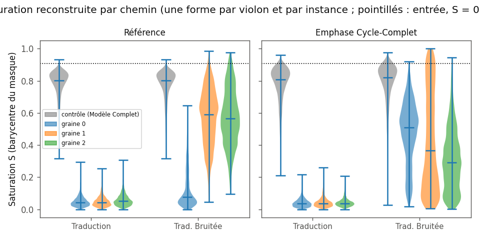
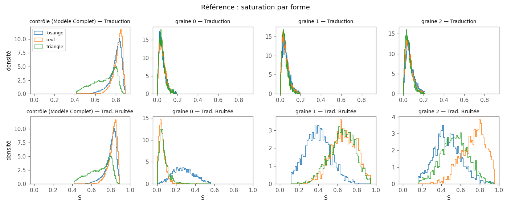
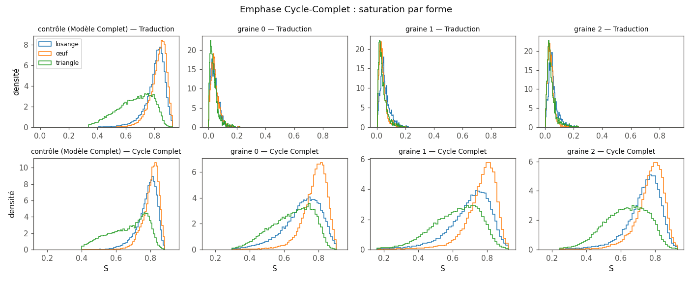
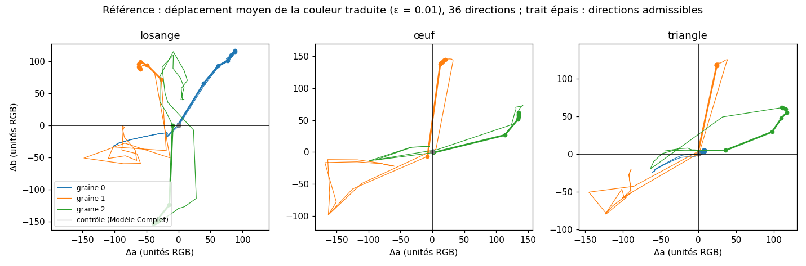
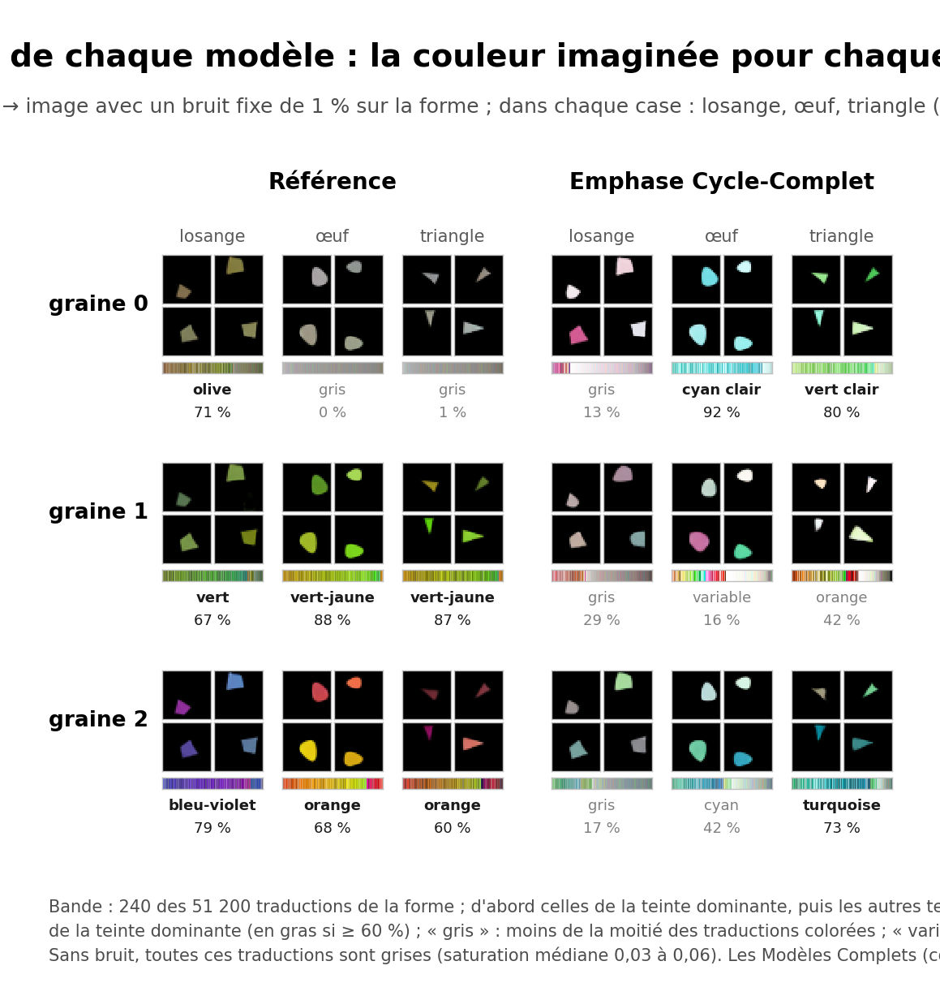
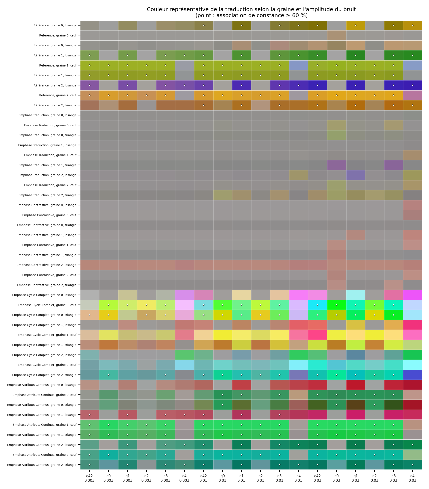
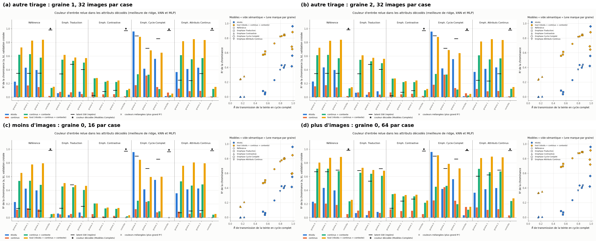

# Supplément

Compléments de l'article [`paper/article.md`](../article.md) : contrôles de mesure, distributions
détaillées, figures complémentaires, robustesse, statistiques complètes et autres réglages explorés.
Réglages présentés : Référence (poids par défaut) et Emphase Cycle-Complet (cohérence de cycle ×10),
trois graines chacun, et leurs contrôles (couleur dans les attributs).

- [S1 — Statistiques de l'intervention sur le résidu de forme](S1_statistiques_intervention.md)
  (dose-réponse, spécificité, résidus produits sur de vraies images, dépendance à la direction ; les
  tableaux couvrent aussi les réglages exploratoires).
- [S2 — Robustesse](S2_robustesse.md) (autre extraction de la couleur, directions et amplitudes du
  résidu, comparaisons multiples, sous-ensembles d'images de la régression).

## Contrôle de mesure

Sur 6 000 images, sans GW, l'extraction redonne S = 0,907 en entrée (0,884 pour les triangles, 0,876
pour la plus petite taille). Le seul passage par le VAE ramène S à 0,80 (losange 0,81, œuf 0,83,
triangle 0,72 ; taille 7 : 0,70, taille 14 : 0,83). Un écart de saturation entre formes ou tailles peut
donc venir de la mesure : chaque comparaison est rapportée aux contrôles.

## Saturation selon le chemin

| Médiane de S (entrée : 0,91) | Reconstruction* | Traduction | Traduction avec résidu de 1 % | Cycle complet* |
|---|---|---|---|---|
| Contrôles | 0,79–0,80 | 0,80–0,83 | 0,80–0,84 | 0,78–0,80 |
| Référence | 0,76 | 0,05 | 0,46 | 0,49 |
| Emphase Cycle-Complet | 0,77 | 0,04 | 0,44 | 0,72 |

\* Valeurs approchées (RGB arrondis à l'entier ; erreur médiane vérifiée < 0,005).

**Figure S1 — Saturation des traductions, sans et avec résidu (valeurs exactes).** Un panneau par
réglage ; un violon par instance (gris : contrôle ; bleu, orange, vert : graines 0, 1, 2) ; trait
horizontal : médiane ; pointillés : saturation d'entrée. Sans résidu, toutes les instances sans couleur
sont grises ; avec un résidu fixe de 1 %, elles se colorent, sauf Référence graine 0.

**Figure S2 — Saturation en reconstruction, traduction et cycle complet (valeurs approchées).** Même
codage. En cycle complet, Emphase Cycle-Complet garde des couleurs saturées pour presque toutes les
images ; chez Référence, la distribution est bimodale (une partie des images ressort saturée, l'autre
grise).

**Figure S3 — Distribution de S par forme et par instance**, traduction (haut) et traduction avec résidu
(bas) ; a : Référence ; b : Emphase Cycle-Complet. Avec le résidu, les formes se séparent différemment
selon l'instance (Emphase Cycle-Complet graine 0 : losanges vers 0,2, œufs et triangles vers 0,6). Chez
les contrôles, les triangles sont moins saturés que les autres formes, avec ou sans résidu : effet de
mesure.

**Figure S4 — Distribution de S par forme en traduction (haut) et en cycle complet (bas, valeurs
approchées).** Emphase Cycle-Complet restitue des couleurs saturées pour les trois formes et les trois
instances, comme son contrôle ; Référence mêle images saturées et grises.

## Direction du résidu et couleur

**Figure S5 — Comme la figure 5, pour Référence.** Le déplacement atteint ±150 unités RGB ; les points des
directions qui restent dans le simplexe sont souvent groupés : la teinte dépend moins de la répartition
du résidu que chez Emphase Cycle-Complet.

**Figure S6 — Teinte de chaque exemple, résidu partagé moitié-moitié (ε = 0,01).** Une ligne par
réglage, une colonne par forme ; un cercle par instance (intérieur : graine 0 ; marqueurs rond, carré,
triangle : graines 0, 1, 2) ; couleur des marqueurs : couleur produite ; traits : teinte moyenne de
chaque instance, de longueur R̄. Chaque instance regroupe ses exemples autour d'une teinte propre
(losanges de Référence : 57°, 124° et 260° selon la graine ; différences entre instances : permutation,
p ≤ 0,04).

## Associations forme → couleur

**Figure S7 — Palette des 6 modèles sans couleur (résidu fixe de 1 %).** Colonnes : réglages et formes ;
lignes : graines ; dans chaque case, 4 traductions, la bande de 240 traductions, la couleur dominante et
sa constance (en gras si ≥ 60 %). « gris » : moins de la moitié des traductions colorées ; « variable » :
moins de la moitié des traductions colorées ont la teinte dominante.

**Figure S8 — Couleur de chaque modèle et de chaque forme selon la direction et l'amplitude du résidu**
(tous les réglages explorés). Lignes : couples modèle × forme ; colonnes : graine du vecteur de résidu (42,
celle de [1], puis 0 à 4) et amplitude (0,003 ; 0,01 ; 0,03) ; point : association sûre (borne basse de
Wilson de la constance ≥ 60 %). Les associations perdues redeviennent surtout grises (écart de teinte
dominante entre directions : médiane 1°), sauf chez Emphase Cycle-Complet graine 0, dont la couleur change
avec la direction du résidu.

## Comparaisons multiples

| % d'instances régulières | Teinte selon l'orientation, traduction : test de [1] → Holm ; critère d'effet | Teinte selon la forme, traduction avec résidu : test de [1] → Holm ; critère d'effet |
|---|---|---|
| Référence | 100 → 33 ; 100 | 100 → 67 ; 100 |
| Emphase Cycle-Complet | 100 → 33 ; 100 | 33 → 33 ; 67 |
| Contrôles | 0 → 0 ; 0 | 0 → 0 ; 0 |

Test de [1] : KS sur histogrammes à 15 classes. Critère d'effet : KS sur valeurs brutes p < 0,05 et
|δ de Cliff| ≥ 0,147, inchangé par la correction (p ≈ 0). Le KS sur valeurs brutes seul est significatif
partout, contrôles compris.

## Robustesse

| Volet | Résultat | Verdict |
|---|---|---|
| Autre extraction (pixel le plus intérieur du masque) | ΔS médian −0,000 à +0,005 ; mêmes associations sûres, mêmes teintes dominantes | tient |
| Direction et amplitude du résidu (6 × 3) | Référence et Emphase Cycle-Complet se colorent quelles que soient la direction et l'amplitude (S médiane à 0,01 : 0,24–0,48 et 0,40–0,58 selon la direction) | tient |
| Associations selon la direction du résidu | stables pour ≥ 4 directions sur 6 et 3 amplitudes : 5 associations de Référence ; aucune d'Emphase Cycle-Complet | tient en partie |
| Régression, autre tirage d'images | R² changés de 0,01 au plus ; classement des modèles conservé | tient |
| Régression, nombre d'images (16, 32, 64 par case) | résidu seul stable ; R² avec la géométrie croissants (bornes basses) | tient |

**Figure S9 — Régression refaite sur d'autres sous-ensembles d'images** (tous les réglages explorés ;
même présentation que la figure 3) : (a, b) autres tirages, 32 images par case ; (c, d) 16 et 64 images
par case. Variantes avec ridge et kNN seulement : le repère « latent du GW » y est sous-estimé ; seule la
comparaison entre panneaux compte.

## Autres réglages explorés

Trois autres réglages ont été entraînés de la même façon (trois graines chacun). Ils ne changent pas les
conclusions et ne sont pas présentés dans l'article :

| | Traduction renforcée (×10) | Alignement contrastif renforcé (0,1 → 1) | Attributs continus pondérés ×5 |
|---|---|---|---|
| S médiane, traduction sans / avec résidu de 1 % | 0,04 / 0,04 | 0,05 / 0,05 | 0,05 / 0,62 |
| R² de la couleur d'entrée : résidu de forme ; tout ; latent du GW | 0,07 ; 0,59 ; 0,94 | 0,00 ; 0,25 ; 0,29 | 0,40 ; 0,90 ; 0,96 |
| Transmission en cycle complet R̄ | 0,54 | 0,18 | 0,84 |
| Lecture | résidu quasi nul : la couleur fuit par les attributs continus, la traduction reste grise | couleur perdue dès l'espace de travail | comme Référence |

## Reproduire

Figures 1, 2, 3, 5, S1 à S7 : `python experiments/paper_figures.py` (à partir des données de
`synesthesia_figure.py`, `shape_noise_sweep.py`, `residual_regression.py`, `saturation_analysis.py`) ;
figure 4 : `colour_code_transplant.py` ; figures 6 et 7 : `colour_code_map.py` ; supplément S1 :
`sweep_statistics.py` ; figures S8, S9 et supplément S2 : `saturation_robustness.py`,
`multiple_testing.py`, `regression_sensitivity.py`, `robustness_statistics.py`.
